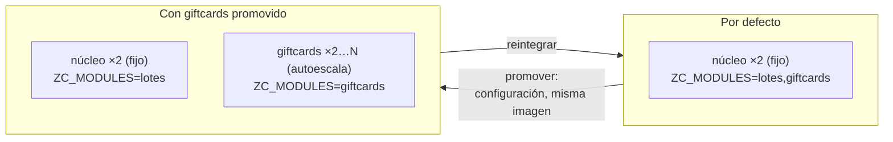
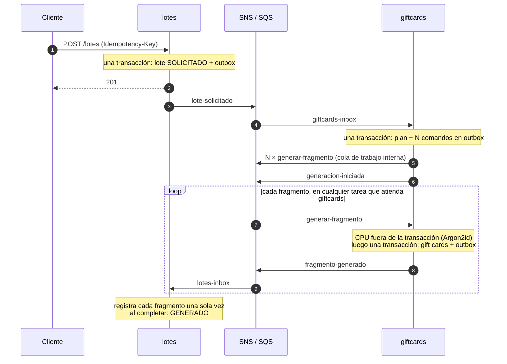

# Zonacards · ejemplo de referencia

Un **monolito modular** en **Java 25 + Quarkus**, con **arquitectura hexagonal y DDD**: una
aplicación, una imagen y dos módulos (`lotes` y `giftcards`) que se comunican **solo por
eventos** (SNS → SQS con *outbox* transaccional). Se despliega en **ECS Fargate** como un solo
servicio, y **un módulo se promueve a servicio propio, con su autoescalado, cambiando
configuración**: sin desarrollo, sin compilar y sin versión nueva. Incluye la librería interna,
la infraestructura en Terraform, el pipeline de CI/CD y un sistema local completo para verlo
funcionar.

Es la prueba ejecutable de la arquitectura propuesta para Zonacards 2.0 (un monolito modular
que escala por módulo): no un esqueleto, sino dos módulos reales con sus reglas, sus fallos
previstos y sus pruebas, y la promoción de uno de ellos ejercitada de ida y vuelta.

- [Qué demuestra](#qué-demuestra)
- [Arranque en 5 minutos](#arranque-en-5-minutos)
- [Cómo está hecho](#cómo-está-hecho)
- [De módulo a servicio propio](#de-módulo-a-servicio-propio)
- [Comunicación por eventos](#comunicación-por-eventos)
- [Escalado de un solo módulo](#escalado-de-un-solo-módulo)
- [Lo que lo hace apto para producción](#lo-que-lo-hace-apto-para-producción)
- [CI/CD e infraestructura](#cicd-e-infraestructura)
- [Qué se ejecutó y qué no](#qué-se-ejecutó-y-qué-no)
- [Mapa de la propuesta al repositorio](#mapa-de-la-propuesta-al-repositorio)
- [Documentación](#documentación) · [Fuentes](#fuentes)

## Qué demuestra

| Afirmación | Dónde se comprueba |
|---|---|
| **Una aplicación, una imagen**; la configuración (`ZC_MODULES`) decide qué módulos atiende cada despliegue | [`docs/arquitectura.md`](docs/arquitectura.md); las pruebas arrancan la aplicación en sus tres formas (solo `lotes`, solo `giftcards`, todo); `make e2e` comprueba que todos los contenedores corren el mismo ID de imagen |
| **Un módulo pasa a servicio propio, y vuelve, sin desarrollo ni versión nueva y sin cortar el servicio** | Local: `make promover` y `make reintegrar`, ejercitados por `make e2e` con un cliente llamando a la API mientras se mueve el tráfico. Terraform: variable `promoted_modules`, con pruebas, plan contra una cuenta real y un ensayo etapa por etapa contra un emulador |
| **Solo el módulo promovido autoescala**; el núcleo mantiene un número fijo de tareas | Terraform: [`infra/terraform/README.md`](infra/terraform/README.md) y sus pruebas; local: `make demo-escalado` |
| Los módulos están separados de verdad aunque compartan proceso: ninguno importa código del otro, ni lee su esquema, ni comparte una transacción | ArchUnit (`ArchitectureTest`, `AppArchitectureTest`); un rol de PostgreSQL por módulo (`AppSagaIT`, escenario `aislamiento` de `make e2e`) |
| Entre módulos, **solo** eventos, también dentro del mismo proceso | `AppSagaIT`: la saga completa con los dos módulos en un proceso, por el emulador de SNS/SQS |
| Un evento nunca se pierde ni se publica sin su cambio de estado | *Outbox* transaccional: [`libs/eventx`](libs/eventx), pruebas `PostgresEventxIT` |
| La entrega duplicada y desordenada no rompe nada | Pruebas de la saga contra PostgreSQL real: [`GeneracionSagaIT`](app/src/test/java/com/zonacards/giftcards/srv/GeneracionSagaIT.java), `LoteEventHandlersTest` |
| La arquitectura de Manifesto (Go) se traslada a Java + Quarkus sin perder su forma: dominio sin framework, puertos, composición explícita, errores tipados, autorización explícita | [`docs/arquitectura.md`](docs/arquitectura.md); reglas verificadas en cada build por `HexagonRules` (ArchUnit) |
| Se puede operar: salud y métricas por módulo, trazas, DLQ con *redrive*, apagado ordenado | [`docs/operacion.md`](docs/operacion.md); escenarios `caida`, `dlq` y `observabilidad` de `make e2e` |
| Se puede entregar: build, pruebas, análisis, una imagen firmada, despliegue con promoción entre ambientes | [`docs/cicd.md`](docs/cicd.md), [`.github/workflows`](.github/workflows) |

Los dos módulos:

- **`lotes`**: solicitud de un lote de gift cards (hasta 200 000), con `Idempotency-Key`,
  consulta, edición de metadatos y anulación. Carga liviana y estable.
- **`giftcards`**: emisión unitaria, consulta, vigencia, activación, anulación y la **generación
  en bloque** de los códigos de un lote. Cada código lleva un CVV protegido con Argon2id, un
  hash deliberadamente costoso en CPU: un lote grande son horas de CPU. Es el módulo que
  **necesita escalar**, y por eso el candidato a servicio propio.

## Arranque en 5 minutos

Requisitos: Docker (con Compose), `make`, `curl` y `jq`. No hace falta JDK ni Maven: el build
corre en contenedores.

```bash
make up                            # construye la imagen y levanta todo, con los dos módulos en el núcleo
make e2e                           # 11 escenarios de punta a punta; promueve giftcards a mitad y lo reintegra al final
make promover MODULO=giftcards     # giftcards pasa a servicio propio: la misma imagen, solo configuración
make topologia                     # qué despliegue atiende cada módulo
make reintegrar MODULO=giftcards   # y vuelve al núcleo
make down                          # detiene y borra el entorno local
```

`make up` deja corriendo: PostgreSQL 18, un emulador de SNS/SQS, Keycloak, Grafana (con Tempo,
Loki y Prometheus), un gateway que enruta por ruta como lo hará el balanceador, la tarea de
migración y **dos réplicas del núcleo**, que atienden los dos módulos.

| Qué | Dónde |
|---|---|
| API | `http://localhost:8080/api/v1` |
| Keycloak | `http://localhost:8081` (admin / admin) |
| Grafana | `http://localhost:3000` |

Un recorrido a mano:

```bash
TOKEN=$(make -s token)                       # usuaria ana: rol operador, tenant pe

# 1. Solicitar un lote: responde 201 de inmediato; la generación es asíncrona
curl -s -X POST localhost:8080/api/v1/lotes \
  -H "Authorization: Bearer $TOKEN" -H 'Content-Type: application/json' \
  -H 'Idempotency-Key: campana-navidad-001' \
  -d '{"descripcion":"Campaña navideña","pais":"604","moneda":"PEN","monto":50.00,
       "cantidad":2000,"vigenciaHasta":"2027-12-31"}' | jq .

# 2. Ver el progreso (SOLICITADO -> EN_GENERACION -> GENERADO)
curl -s localhost:8080/api/v1/lotes/<id> -H "Authorization: Bearer $TOKEN" | jq '{estado, progreso}'

# 3. Las gift cards del lote: el código nunca vuelve a mostrarse, solo su máscara
curl -s "localhost:8080/api/v1/giftcards?loteId=<id>&pageSize=3" -H "Authorization: Bearer $TOKEN" | jq .

# 4. Anular el lote: todas sus gift cards quedan ANULADA, también si aún se están generando
curl -s -X DELETE "localhost:8080/api/v1/lotes/<id>?motivo=Cancelada" -H "Authorization: Bearer $TOKEN" | jq .
```

El recorrido es idéntico con `giftcards` en el núcleo o promovido: la API, los datos y los
eventos no cambian.

Usuarios del entorno local (la contraseña es el nombre de usuario): `ana` (operador, Perú),
`luis` (solo consulta, Perú), `eva` (operador, Ecuador). `USUARIO=luis make -s token` muestra un
403 al crear; con `eva` un lote de Perú responde 404.

Otros comandos: `make help`.

## Cómo está hecho

```
libs/                      la librería interna (equivalente a pkg/ de Manifesto)
  errx  kernel  logx  ptrx  asyncx  dbx      sin framework: solo JDK
  eventx                                      eventos: sobre, outbox, consumidor, saga
  eventx-postgres  eventx-aws                 adaptadores: JDBC y SNS/SQS
  server                                      el único que conoce Quarkus; decide qué módulos atiende un despliegue
  testkit                                     reglas de arquitectura, contratos, fixtures
app/                       LA aplicación: un artefacto, una imagen
  com.zonacards.app                           contenedor raíz: la lista de módulos
  com.zonacards.lotes                         un módulo
  com.zonacards.giftcards                     otro módulo
infra/terraform/           módulos, ambientes dev/qa/prod y raíz local (emulador)
deploy/                    bootstrap de la base (el mismo en pruebas, local y AWS) y entorno local
.github/workflows/         ci, security, build-push, deploy, terraform
docs/                      arquitectura, eventos (AsyncAPI), escalado, operación, CI/CD, decisiones
```

Cada módulo tiene la misma forma, la de Manifesto:

```
com.zonacards.giftcards
  GiftCard, Plan, GiftCardRepository, CodigoProtector, GiftCardErrors   dominio y puertos (solo JDK)
  events/        eventos que publica y su propia vista de los que consume
  srv/           casos de uso: autorizar -> validar -> transacción { repositorio + outbox }
  infra/         adaptadores: SQL explícito, AES-GCM, Argon2id
  api/           REST: convierte en el borde, no contiene reglas
  container/     composición explícita: el único paquete que conoce todas las piezas
```

Las fronteras no son una convención: `HexagonRules.check(...)` falla el build si el dominio
importa un framework, si `api` toca `infra`, si un módulo importa a otro o si alguien usa
`@Transactional` en lugar del puerto `UnitOfWork`. Y lo que ArchUnit no puede ver lo impone la
base de datos: cada módulo se conecta con su propio rol, que solo ve su esquema, y una
transacción no puede abarcar dos módulos. El detalle, y la tabla de equivalencias Manifesto →
Java, están en [`docs/arquitectura.md`](docs/arquitectura.md).

Stack: Java 25, Quarkus 3.40 LTS, JDBC + Flyway (sin ORM), PostgreSQL 18, AWS SDK v2,
Keycloak (OIDC), OpenTelemetry + Micrometer, JUnit 6, Testcontainers, ArchUnit, Terraform 1.16.
El porqué de cada elección está en [`docs/decisiones.md`](docs/decisiones.md).

## De módulo a servicio propio

La imagen **contiene** siempre todos los módulos. Cada despliegue **atiende** los que lista en
`ZC_MODULES`. Un módulo no atendido no se construye: no expone su API (responde `404
MODULE_NOT_SERVED`), no arranca sus consumidores y no necesita sus credenciales.



En AWS es una variable de Terraform. Por cada módulo de la lista se crea su servicio, su lugar
en la regla del balanceador y su política de autoescalado:

```hcl
promoted_modules = {
  giftcards = {
    autoscaling = {
      min        = 2
      max        = 10
      cpu_target = 60
      queue      = { name = "giftcards-generacion", backlog_per_task_target = 10 }
    }
  }
}
```

**Una precisión que el ejemplo dice sin rodeos.** "Agregar a la lista y aplicar", hecho en un
solo paso, cortaría el servicio del módulo: el balanceador cambiaría de destino antes de que el
servicio nuevo tuviera tareas sanas. Lo que aquí se implementa y se prueba son **dos cambios de
infraestructura y un redespliegue de la misma versión**:

| | Qué pasa | Quién atiende el módulo | Su API va a |
|---|---|---|---|
| 1. Expandir | Se crea el servicio propio con la versión que ya está desplegada | núcleo **y** servicio propio | núcleo |
| 2. Contraer | El tráfico pasa al servicio propio; el núcleo suelta el módulo al redesplegar la **misma etiqueta** | servicio propio | servicio propio |

Mientras dos despliegues atienden el módulo no se pierde ni se duplica nada: compiten por las
mismas colas, los manejadores son idempotentes y el *relay* del *outbox* usa un *lease*. Volver
al núcleo es el camino inverso, con un paso más (tres cambios y un redespliegue), porque retirar
un servicio lo destruye de inmediato. Sigue siendo cierto lo esencial: **sin desarrollo, sin
compilar y sin versión nueva**.

Lo que `make e2e` comprueba al promover en local, con un cliente llamando a las dos API
mientras el tráfico cambia de despliegue y el núcleo se redespliega: ninguna petición falla; el
servicio nuevo corre el **mismo ID de imagen**; un lote generado durante el solape queda exacto,
con fragmentos generados por los dos despliegues; el núcleo deja de consumir las colas del
módulo y su API responde `404 MODULE_NOT_SERVED`; los datos siguen ahí; y una sola traza une la
petición en el núcleo con el consumo en el servicio propio.

Procedimiento, estados intermedios y qué comprobar en cada paso:
[`docs/operacion.md`](docs/operacion.md#promover-un-módulo-a-servicio-propio) e
[`infra/terraform/README.md`](infra/terraform/README.md).

## Comunicación por eventos



El diagrama es el mismo con los dos módulos en el núcleo o con `giftcards` en su servicio.

- **Entre módulos, solo eventos, también en el mismo proceso.** Cada módulo publica hechos en
  su topic; cada consumidor tiene su cola con su DLQ y un filtro por tipo. No hay llamadas
  directas ni un atajo en memoria cuando comparten proceso: por eso mover un módulo no cambia
  nada de su código.
- **Outbox transaccional.** El evento se escribe en la misma transacción que el cambio de
  estado; un *relay* lo publica después. Si la publicación falla, se reintenta; si la tarea
  cae, otra continúa.
- **La garantía que se declara es la real: al menos una vez, sin orden.** Todo consumidor es
  idempotente (*inbox* en la misma transacción que el efecto) y cada regla de la saga está
  escrita para soportar duplicados y desorden. Las pruebas entregan los mensajes barajados,
  repetidos y desde varios hilos a la vez.
- **Trabajo interno por cola directa.** Partir un lote en fragmentos es un detalle de
  `giftcards`: esos comandos van a su propia cola, no al topic público. Esa cola es la señal de
  autoescalado.
- **Contratos probados en los dos lados.** Un ejemplo JSON por tipo de evento
  ([`docs/eventos/ejemplos`](docs/eventos/ejemplos)) lo validan las pruebas del productor y las
  del consumidor. No hay código compartido entre módulos.

Catálogo, garantías y evolución de contratos: [`docs/eventos/README.md`](docs/eventos/README.md)
y [`docs/eventos/asyncapi.yaml`](docs/eventos/asyncapi.yaml).

Las reglas que hacen correcta la saga (anulación antes, durante y después de generar; caída a
mitad de un fragmento; colisiones de código; fallo terminal) están explicadas en
[`docs/arquitectura.md`](docs/arquitectura.md#la-saga-de-emisión).

## Escalado de un solo módulo

Tres mediciones locales, cada una con un guion que imprime solo lo que mide en esa corrida:

```bash
make demo-promocion      # por qué promover: la API de lotes mientras se genera un lote grande
make demo-escalado       # el mismo lote con 1, 2 y 4 réplicas de giftcards promovido; el núcleo no cambia
make demo-autoescalado   # SIMULACIÓN de la política sobre la cola real
```

**Por qué promover.** `make demo-promocion` del 19 de noviembre de 2026: tiempos de respuesta
de `GET /api/v1/lotes`, vistos por un cliente, mientras se genera un lote de 6 000 gift cards
(cada réplica limitada a 1 vCPU):

| Topología | vCPU en total | Lote (s) | Peticiones a `lotes` | Fallidas | p50 (ms) | p95 (ms) | p99 (ms) |
|---|---:|---:|---:|---:|---:|---:|---:|
| núcleo ×2, sin generar | 2 | - | 478 | 0 | 5 | 6 | 8 |
| núcleo ×2, generando | 2 | 180,4 | 2 405 | 0 | 5 | 26 | 49 |
| núcleo ×4, generando | 4 | 138,2 | 1 478 | 0 | 11 | 50 | 83 |
| núcleo ×2 + `giftcards` ×2, generando | 4 | 183,6 | 2 434 | 0 | 5 | 16 | 20 |

- Generar dentro del núcleo no hace fallar la API de `lotes`, pero la vuelve irregular: el p99
  pasa de 8 a 49 ms.
- Escalar el núcleo entero no lo arregla: cada réplica nueva también genera. Con el doble de
  vCPU la API quedó peor (p99 de 83 ms).
- Con esos mismos 4 vCPU y el módulo promovido, el p99 baja a 20 ms y la mediana vuelve a 5 ms.
  El lote tarda lo mismo: promover no lo acelera, lo **aísla**, y deja su capacidad lista para
  crecer por separado.

Son diferencias de decenas de milisegundos, con un solo cliente y en un portátil: muestran el
mecanismo, no son una prueba de carga. Una segunda corrida dio el mismo cuadro.

**Escalar el módulo promovido.** `make demo-escalado` del mismo día (lote de 4 000 gift cards
en 16 fragmentos; cada réplica de `giftcards` limitada a 1 vCPU):

| Réplicas de giftcards | Réplicas del núcleo | Tiempo (s) | Gift cards/s | Aceleración | Fragmentos por réplica |
|---:|---:|---:|---:|---:|---|
| 1 | 2 | 118,5 | 34 | 1,00x | 16 |
| 2 | 2 | 97,2 | 41 | 1,22x | 9 + 7 |
| 4 | 2 | 81,9 | 49 | 1,45x | 4 + 4 + 4 + 4 |

Cómo leerlo, sin adornos:

- **Lo que depende del diseño se cumple**: las réplicas que se agregan toman trabajo de la misma
  cola, cada fragmento se genera una sola vez (última columna), el lote termina antes y el
  núcleo no cambia.
- **La aceleración queda lejos de la lineal y cambia de una corrida a otra.** El portátil de la
  prueba trabaja en su tope térmico: una prueba de CPU pura, ajena a la aplicación, rinde en él
  2,9 veces con cuatro procesos, no 4. Por debajo de ese techo, con cuatro réplicas se ha
  medido entre 1,45x y 1,92x según la corrida y la configuración del hash del CVV, que es caro
  en memoria a propósito. Las mediciones no aíslan cuánto pesa cada causa, y
  [`docs/autoescalado.md`](docs/autoescalado.md) lo dice así.
- En Fargate cada tarea recibe su propia asignación de CPU en hosts distintos. La cifra local
  demuestra el mecanismo; el dimensionamiento debe medirse allí.

Qué es real y qué no en estas demos, cómo se calibra el objetivo de *backlog* y por qué el
escalado en AWS está validado por plan y no observado: [`docs/autoescalado.md`](docs/autoescalado.md).

## Lo que lo hace apto para producción

**Seguridad**
- API protegida con tokens OIDC de Keycloak: firma, emisor, audiencia y vigencia verificados.
- Autorización explícita como primera línea de cada caso de uso (`Authz.require(auth, tenant, scope)`),
  con pruebas que demuestran que nada toca el repositorio antes de autorizar.
- Aislamiento por *tenant* en cada consulta: un recurso de otro tenant responde 404.
- El código de la gift card se guarda cifrado (AES-256-GCM) con un índice ciego (HMAC) para
  garantizar unicidad; el CVV, solo como hash Argon2id. Ambos se muestran una única vez.
- Contenedor sin privilegios; secretos desde Secrets Manager, nunca en variables en claro ni en
  el estado de Terraform; el servicio de un módulo promovido recibe solo los secretos y los
  permisos IAM de ese módulo.

**Datos**
- Un esquema por módulo y dos roles por módulo: el dueño (solo la tarea de migración) y el de
  ejecución (solo DML, con límite de conexiones). Un módulo no puede leer el esquema del otro,
  compartan proceso o no.
- Migraciones con Flyway en una tarea separada antes de cada despliegue; la aplicación en
  ejecución no tiene credenciales para alterar tablas.
- Presupuesto de conexiones por módulo verificado por Terraform, dimensionado para el momento
  en que el núcleo y un servicio propio atienden el módulo a la vez.
- Bloqueo optimista en las ediciones; idempotencia en la creación de lotes.

**Operación**
- Un despliegue mal cableado no arranca: cada módulo comprueba al iniciar que tiene sus topics,
  sus colas y sus llaves, y `ZC_MODULES` vacía o con un nombre desconocido detiene el arranque.
  En ECS eso es un despliegue que falla y vuelve atrás solo.
- *Liveness* por módulo, que incluye el latido de su *relay* y de sus consumidores; métricas de
  outbox y de consumo con la etiqueta `module`; logs JSON con `request_id`, `tenant_id` y
  `traceId`; una traza une la petición HTTP con el consumo en el otro módulo, esté donde esté.
- Reintentos con espera creciente, DLQ por cola con alarma, y *redrive* probado.
- Apagado ordenado dentro del `stopTimeout` de ECS: corta la recepción, devuelve lo no iniciado,
  termina lo que está en curso; los módulos de una tarea se detienen a la vez.
- Despliegue *rolling* con *circuit breaker* y *rollback* automático; los servicios se
  actualizan en orden y el núcleo al final.

**Calidad**
- 197 pruebas automáticas (unitarias, integración con PostgreSQL 18 y SNS/SQS emulado, API
  con JWT reales, arquitectura) y 47 pruebas nativas de Terraform. Los 11 escenarios de
  `make e2e` cubren lo que solo se ve con el sistema completo, en las dos topologías.

Lo que **no** incluye, a propósito: Keycloak en producción (es del cliente y entra como
variable), API Gateway, caché, WAF/CDN, tableros y alertas más allá de las alarmas de colas, y
pruebas de carga.

## CI/CD e infraestructura

| Workflow | Hace | Etapa equivalente del pipeline de la propuesta |
|---|---|---|
| `ci.yml` | build, pruebas unitarias y de integración, arquitectura, cobertura | compilación, pruebas, cobertura |
| `security.yml` | análisis estático, dependencias, secretos, IaC; SonarQube y Snyk si hay token | SonarQube, Snyk, análisis de IaC |
| `build-push.yml` | **una** imagen multi-arquitectura, escaneo bloqueante, SBOM, firma, ECR por OIDC | imagen y registro |
| `deploy.yml` | una migración y los servicios del ambiente en orden: `dev` automático; `qa` y `prod` con aprobación | despliegue y promoción |
| `terraform.yml` | formato, validación, lint, escaneo, pruebas, ensayo de la promoción y plan en cada PR | infraestructura como código |

El pipeline no tiene escrito ningún nombre de servicio: lee de un parámetro que mantiene
Terraform qué servicios tiene el ambiente. Promover un módulo no toca ningún workflow ni
ninguna variable de GitHub.

Detalle, variables a configurar y *rollback*: [`docs/cicd.md`](docs/cicd.md).
Infraestructura módulo por módulo: [`infra/terraform/README.md`](infra/terraform/README.md).

## Qué se ejecutó y qué no

Este repositorio no presenta un build en verde como prueba de producción. Esto es lo que
respalda cada afirmación:

| | Estado | Evidencia |
|---|---|---|
| Build completo y 197 pruebas (`make verify`) | **Ejecutado** | PostgreSQL 18 y emulador SNS/SQS reales vía Testcontainers; la aplicación arrancada en sus tres formas: solo `lotes`, solo `giftcards` y todo |
| La imagen de la aplicación | **Ejecutado** | `make images`: una sola imagen |
| Sistema local completo (`make up`) | **Ejecutado** | 2 réplicas del núcleo con los dos módulos, Keycloak 26.8, una tarea de migración |
| Escenarios de punta a punta (`make e2e`) | **Ejecutado** | 11 escenarios: seguridad, saga, emisión unitaria, caída con `kill -9`, DLQ + *redrive*, aislamiento de esquemas, observabilidad, **promoción**, anulación antes/durante/después, escalado y **reintegración** |
| Promover y reintegrar un módulo en local | **Ejecutado** | dentro de `make e2e`: misma imagen, 0 peticiones fallidas durante el cambio, lote exacto mientras dos despliegues atienden el módulo, datos intactos |
| Módulo Terraform de mensajería | **Aplicado contra el emulador** | lo aplica `make up`; reaplicarlo no produce cambios |
| Terraform: `fmt`, `validate` (5 raíces), 47 pruebas nativas, tflint, trivy | **Ejecutado** | sin credenciales, con proveedores simulados; las pruebas recorren la promoción y la vuelta estado por estado |
| Ensayo de la promoción en Terraform (`make ensayo-terraform`) | **Ejecutado contra un emulador** | el proveedor real de AWS planifica y aplica cada etapa en un emulador desechable: la regla del balanceador cambia en el sitio y nada se destruye hasta retirar el servicio. Encontró un defecto real, ya corregido. Tabla y límites en [`infra/terraform/README.md`](infra/terraform/README.md#ensayo-de-la-promoción-con-el-proveedor-real) |
| Contratos de eventos (AsyncAPI) | **Validado** | los 11 ejemplos cumplen su esquema |
| `terraform plan` contra una cuenta AWS real | **Ejecutado** | sin errores ni advertencias: `dev` 105 recursos (121 con `giftcards` promovido), `qa` 102 (118), `prod` 124 (140), `bootstrap` 7; el autoescalado aparece solo en el servicio de `giftcards`. Detalle y límites en [`infra/terraform/README.md`](infra/terraform/README.md#plan-contra-una-cuenta-real) |
| `terraform apply` en AWS | **No ejecutado** | decisión: no se crean recursos en la cuenta |
| Promover un módulo en AWS | **No ejecutado** | validado por pruebas, plan real y ensayo contra el emulador; el recorrido completo, con tráfico, solo se ha ejercitado en local |
| Autoescalado real en ECS | **No observado** | definido y planificado contra una cuenta real; en local se simula el controlador |
| Workflows de GitHub Actions | **Parcial** | `actionlint` sin hallazgos y los scripts de construcción y despliegue ejecutados en local contra un AWS CLI simulado (11 casos de despliegue). En GitHub han corrido los que no necesitan AWS; `build-push` y `deploy` nunca. Detalle en [`docs/cicd.md`](docs/cicd.md#qué-se-validó-y-qué-no) |
| Demos locales (`make demo-promocion`, `make demo-escalado`, `make demo-autoescalado`) | **Ejecutado** | cifras de este documento; limitadas por el equipo de prueba, como se explica arriba |
| Prueba de carga y dimensionamiento | **No ejecutado** | el objetivo de *backlog* por tarea debe calibrarse en Fargate |

Limitaciones conocidas del entorno local: el emulador entrega mensajes a una conexión de
*long polling* que ya se cerró (el mensaje reaparece al vencer su *visibility timeout*), el
controlador de autoescalado es una simulación, y el gateway local (nginx) no reproduce el
drenaje de conexiones del balanceador de AWS. Están descritas donde corresponde.

## Mapa de la propuesta al repositorio

Secciones 5 (arquitectura) y 6 (escalado) de la propuesta por fases. Las cifras de la propuesta
no se reproducen aquí.

| En la propuesta | En este repositorio | Diferencia o límite |
|---|---|---|
| **5.1** Un módulo por dominio, con sus reglas y su esquema; se comunican solo por interfaces definidas y por eventos; ningún módulo lee las tablas de otro | Paquetes `com.zonacards.lotes` y `com.zonacards.giftcards`; ArchUnit; un rol de PostgreSQL por módulo | El ejemplo toma la opción más estricta: **solo eventos**, también dentro del mismo proceso. Es lo que hace que promover sea un cambio de configuración |
| **5.1** Una sola base de código y una única imagen; la configuración decide qué módulos atiende cada despliegue | `app/`, un `Dockerfile`, `ZC_MODULES` (`libs/server`) | — |
| **5.1** Lo inmediato y lo pesado van por caminos distintos | `POST /lotes` responde de inmediato; la generación va por la cola `giftcards-generacion` | — |
| **5.1** Sin estado en memoria: cualquier copia atiende cualquier solicitud | Ninguna réplica guarda estado; cualquier tarea toma cualquier fragmento; la clave de idempotencia vive en la base | El ejemplo no usa caché |
| **5.4** El evento se registra en la misma transacción que la operación; reintentos con espera creciente; cola de errores con alerta; reproceso | `libs/eventx*`: *outbox*, *inbox*, DLQ con alarma, *redrive* (`make e2e dlq`) | El reproceso se hace por *redrive* de SQS, no desde una pantalla |
| **5.6** Un esquema por módulo en la misma instancia de PostgreSQL 18, con un usuario de mínimo privilegio por módulo | `deploy/db/bootstrap-service.sql`, migraciones por módulo, `make e2e aislamiento` | Sin particionado ni libro de movimientos: no son parte de este ejemplo |
| **5.7** Ambientes definidos con Terraform; pipeline con compuertas de calidad y seguridad; despliegue con comprobación de salud y reversión automática | `infra/terraform/envs/{dev,qa,prod}`; `.github/workflows`; *circuit breaker* de ECS | El pipeline es de GitHub Actions; `docs/cicd.md` trae la equivalencia etapa por etapa con Jenkins |
| **6.1** Cada servicio con su política de autoescalado en Terraform; los servicios por colas escalan por mensajes pendientes por copia | Bloque `autoscaling` de `modules/ecs-service`: CPU y *backlog* por tarea | El servicio de `giftcards` no baja a cero: también atiende su API. El núcleo del ejemplo es fijo, aunque admite el mismo bloque |
| **6.2** Terraform recibe la lista de módulos con servicio propio y crea para cada uno el servicio, su ruta en el balanceador y su política de autoescalado | Variable `promoted_modules` y catálogo de módulos (`infra/terraform/modules/platform`) | — |
| **6.2** Promover un módulo es agregarlo a la lista y aplicar: sin desarrollo ni versión nueva | `make promover` en local; `promoted_modules` en AWS | Sin desarrollo ni versión nueva, sí. Pero son **dos cambios de infraestructura y un redespliegue**, no uno: en un solo paso habría un corte |
| **6.2** El procedimiento se entrega documentado y se ejercita | [`docs/operacion.md`](docs/operacion.md); `make e2e`; pruebas, plan real y ensayo de Terraform | Ejercitado en local y contra un emulador; **no en AWS** |
| **6.4** Conexiones a la base acotadas por copia | *Pool* por módulo y presupuesto de conexiones verificado al planificar | — |
| **6.6** Pruebas de carga y de autoescalado | `make demo-escalado`, `make demo-autoescalado` | Demostraciones en un portátil, no pruebas de carga |
| Keycloak como proveedor de identidad | `libs/server` (OIDC), realm local en `deploy/local/keycloak` | Keycloak de producción es del cliente |
| Observabilidad con OpenTelemetry | Trazas, métricas y logs por módulo; Grafana local | Sin tableros ni alertas de capacidad |

No están en el ejemplo, y no se afirma nada sobre ellos: API Gateway y cuotas por cliente,
caché, funciones serverless, frontend, escalado programado, WAF y CDN.

## Documentación

| Documento | Contenido |
|---|---|
| [`docs/arquitectura.md`](docs/arquitectura.md) | La aplicación y sus módulos, el hexágono, la librería interna, Manifesto → Java, la saga y sus reglas |
| [`docs/decisiones.md`](docs/decisiones.md) | Decisiones de arquitectura, sus alternativas y lo que cuestan; la primera, el monolito modular frente a microservicios |
| [`docs/eventos/README.md`](docs/eventos/README.md) | Catálogo de eventos, sobre CloudEvents, garantías, topología, evolución |
| [`docs/eventos/asyncapi.yaml`](docs/eventos/asyncapi.yaml) | Contrato formal (AsyncAPI 3.0) |
| [`docs/autoescalado.md`](docs/autoescalado.md) | Por qué promover, diseño del escalado, calibración, demos locales y sus límites |
| [`docs/operacion.md`](docs/operacion.md) | *Runbook*: promover y reintegrar un módulo, DLQ, outbox, lotes atascados, despliegue, apagado |
| [`docs/cicd.md`](docs/cicd.md) | Workflows, compuertas, roles OIDC, *rollback* |
| [`docs/desarrollo.md`](docs/desarrollo.md) | Compilar, probar, agregar un módulo o un evento |
| [`infra/terraform/README.md`](infra/terraform/README.md) | Módulos de Terraform, `promoted_modules`, ambientes, secretos, validación, primer despliegue |

## Fuentes

Arquitectura de referencia
- Manifesto: <https://github.com/Abraxas-365/manifesto> · [documentación](https://github.com/Abraxas-365/manifesto/blob/main/docs/README.md)

Patrones
- *Transactional outbox*: <https://microservices.io/patterns/data/transactional-outbox.html>
- *Idempotent consumer*: <https://microservices.io/patterns/communication-style/idempotent-consumer.html>
- CloudEvents 1.0: <https://github.com/cloudevents/spec/releases>
- AsyncAPI: <https://www.asyncapi.com/docs/reference/specification/latest>

AWS
- Autoescalado de servicios ECS: <https://docs.aws.amazon.com/AmazonECS/latest/developerguide/service-auto-scaling.html>
- Escalar un servicio ECS por una cola SQS (backlog por tarea): <https://docs.aws.amazon.com/AmazonECS/latest/developerguide/service-autoscaling-queue.html>
- *Target tracking* con *metric math*: <https://docs.aws.amazon.com/autoscaling/application/userguide/application-auto-scaling-target-tracking-metric-math.html>
- Suscribir una cola SQS a un topic SNS: <https://docs.aws.amazon.com/sns/latest/dg/subscribe-sqs-queue-to-sns-topic.html>
- Entrega cruda de mensajes: <https://docs.aws.amazon.com/sns/latest/dg/sns-large-payload-raw-message-delivery.html>
- Cifrado de topics con colas suscritas: <https://docs.aws.amazon.com/sns/latest/dg/sns-enable-encryption-for-topic-sqs-queue-subscriptions.html>
- Secretos de Secrets Manager en ECS: <https://docs.aws.amazon.com/AmazonECS/latest/developerguide/secrets-envvar-secrets-manager.html>
- *Deployment circuit breaker*: <https://docs.aws.amazon.com/AmazonECS/latest/developerguide/deployment-circuit-breaker.html>
- SNS, SQS o EventBridge: <https://docs.aws.amazon.com/decision-guides/latest/sns-or-sqs-or-eventbridge/sns-or-sqs-or-eventbridge.html>
- Versiones de PostgreSQL en RDS: <https://docs.aws.amazon.com/AmazonRDS/latest/PostgreSQLReleaseNotes/postgresql-versions.html>
- Estado remoto de Terraform en S3: <https://developer.hashicorp.com/terraform/language/backend/s3>

Quarkus y herramientas
- Versiones y LTS: <https://quarkus.io/releases> · [3.40](https://quarkus.io/blog/quarkus-3-40-released/) · [guía de migración a 4.0](https://github.com/quarkusio/quarkus/wiki/Migration-Guide-4.0)
- OIDC como *resource server*: <https://quarkus.io/guides/security-oidc-bearer-token-authentication>
- Hilos virtuales: <https://quarkus.io/guides/virtual-threads>
- Flyway: <https://quarkus.io/guides/flyway> · Fuentes de datos: <https://quarkus.io/guides/datasource>
- OpenTelemetry: <https://quarkus.io/guides/opentelemetry-tracing> · Micrometer: <https://quarkus.io/guides/telemetry-micrometer> · Salud: <https://quarkus.io/guides/smallrye-health>
- Extensión Amazon SQS: <https://quarkus.io/extensions/io.quarkiverse.amazonservices/quarkus-amazon-sqs/>
- ArchUnit: <https://www.archunit.org/userguide/html/000_Index.html>
- `SELECT … FOR UPDATE SKIP LOCKED` y `FOR SHARE`: <https://www.postgresql.org/docs/current/sql-select.html>
- Emulador local Floci: <https://github.com/floci-io/floci>
