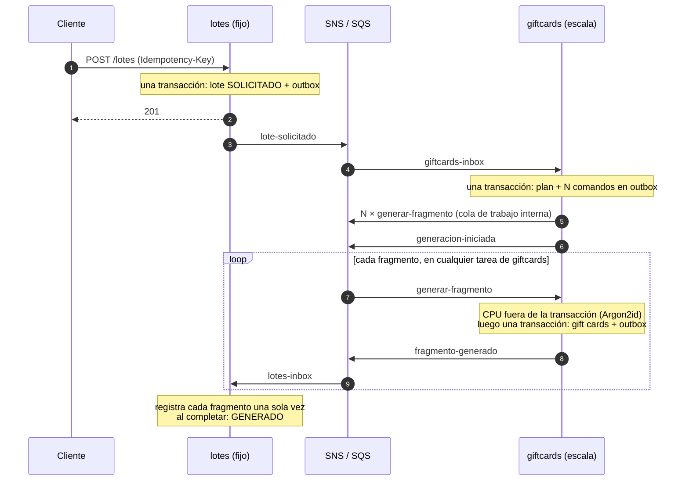

# Zonacards · ejemplo de referencia

Dos microservicios **Java 25 + Quarkus** con **arquitectura hexagonal y DDD**, que se comunican
**solo por eventos** (SNS → SQS con *outbox* transaccional) y se despliegan en **ECS Fargate**,
donde **solo uno de los dos dominios autoescala**. Incluye la librería interna, la
infraestructura en Terraform, el pipeline de CI/CD y un sistema local completo para verlo
funcionar.

Es la prueba ejecutable de la arquitectura propuesta para Zonacards 2.0: no un esqueleto, sino
dos dominios reales con sus reglas, sus fallos previstos y sus pruebas.

- [Qué demuestra](#qué-demuestra)
- [Arranque en 5 minutos](#arranque-en-5-minutos)
- [Cómo está hecho](#cómo-está-hecho)
- [Comunicación por eventos](#comunicación-por-eventos)
- [Autoescalado de un solo dominio](#autoescalado-de-un-solo-dominio)
- [Lo que lo hace apto para producción](#lo-que-lo-hace-apto-para-producción)
- [CI/CD e infraestructura](#cicd-e-infraestructura)
- [Qué se ejecutó y qué no](#qué-se-ejecutó-y-qué-no)
- [Mapa de la propuesta al repositorio](#mapa-de-la-propuesta-al-repositorio)
- [Documentación](#documentación) · [Fuentes](#fuentes)

## Qué demuestra

| Afirmación | Dónde se comprueba |
|---|---|
| La arquitectura de Manifesto (Go) se traslada a Java + Quarkus sin perder su forma: dominio sin framework, puertos, composición explícita, errores tipados, autorización explícita | [`docs/arquitectura.md`](docs/arquitectura.md); reglas verificadas en cada build por `HexagonRules` (ArchUnit) |
| Dos dominios se comunican **solo** por eventos: ninguno importa código del otro, ninguno lee la base del otro | `ArchitectureTest` de cada servicio; roles de PostgreSQL (escenario `aislamiento` de `make e2e`) |
| Un evento nunca se pierde ni se publica sin su cambio de estado | *Outbox* transaccional: [`libs/eventx`](libs/eventx), pruebas `PostgresEventxIT` |
| La entrega duplicada y desordenada no rompe nada | Pruebas de la saga contra PostgreSQL real: [`GeneracionSagaIT`](services/giftcards-service/src/test/java/com/zonacards/giftcards/srv/GeneracionSagaIT.java), `LoteEventHandlersTest` |
| **Solo `giftcards` escala horizontalmente**; `lotes` mantiene un número fijo de tareas | Terraform: [`infra/terraform/envs/dev/main.tf`](infra/terraform/envs/dev/main.tf) y sus pruebas; local: `make demo-escalado` |
| Se puede operar: salud, métricas, trazas entre servicios, DLQ con *redrive*, apagado ordenado | [`docs/operacion.md`](docs/operacion.md); escenarios `caida`, `dlq` y `observabilidad` de `make e2e` |
| Se puede entregar: build, pruebas, análisis, imagen firmada, despliegue con promoción | [`docs/cicd.md`](docs/cicd.md), [`.github/workflows`](.github/workflows) |

Los dos dominios:

- **`lotes`**: solicitud de un lote de gift cards (hasta 200 000), con `Idempotency-Key`,
  consulta, edición de metadatos y anulación. Carga liviana y estable: **réplicas fijas**.
- **`giftcards`**: emisión unitaria, consulta, vigencia, activación, anulación y la **generación
  en bloque** de los códigos de un lote. Cada código lleva un CVV protegido con Argon2id, un
  hash deliberadamente costoso en CPU: un lote grande son horas de CPU. Es el dominio que
  **necesita escalar**, y el único que lo hace.

## Arranque en 5 minutos

Requisitos: Docker (con Compose), `make`, `curl` y `jq`. No hace falta JDK ni Maven: el build
corre en contenedores.

```bash
make up          # construye las imágenes y levanta todo (la primera vez descarga dependencias)
make e2e         # 9 familias de escenarios de punta a punta, con tokens reales de Keycloak
make down        # detiene y borra el entorno local
```

`make up` deja corriendo: PostgreSQL 18, un emulador de SNS/SQS, Keycloak, Grafana (con Tempo,
Loki y Prometheus), un gateway que enruta por ruta como lo hará el balanceador, las tareas de
migración y **dos réplicas de cada servicio**.

| Qué | Dónde |
|---|---|
| API | `http://localhost:8080/api/v1` |
| Keycloak | `http://localhost:8081` (admin / admin) |
| Grafana | `http://localhost:3000` |

Un recorrido a mano:

```bash
TOKEN=$(make -s token)                       # usuaria ana: rol operador, tenant pe

# 1. Solicitar un lote: responde 201 de inmediato; la generación es asíncrona
curl -s -X POST localhost:8080/api/v1/lotes \
  -H "Authorization: Bearer $TOKEN" -H 'Content-Type: application/json' \
  -H 'Idempotency-Key: campana-navidad-001' \
  -d '{"descripcion":"Campaña navideña","pais":"604","moneda":"PEN","monto":50.00,
       "cantidad":2000,"vigenciaHasta":"2027-12-31"}' | jq .

# 2. Ver el progreso (SOLICITADO -> EN_GENERACION -> GENERADO)
curl -s localhost:8080/api/v1/lotes/<id> -H "Authorization: Bearer $TOKEN" | jq '{estado, progreso}'

# 3. Las gift cards del lote: el código nunca vuelve a mostrarse, solo su máscara
curl -s "localhost:8080/api/v1/giftcards?loteId=<id>&pageSize=3" -H "Authorization: Bearer $TOKEN" | jq .

# 4. Anular el lote: todas sus gift cards quedan ANULADA, también si aún se están generando
curl -s -X DELETE "localhost:8080/api/v1/lotes/<id>?motivo=Cancelada" -H "Authorization: Bearer $TOKEN" | jq .
```

Usuarios del entorno local (la contraseña es el nombre de usuario): `ana` (operador, Perú),
`luis` (solo consulta, Perú), `eva` (operador, Ecuador). `USUARIO=luis make -s token` muestra un
403 al crear; con `eva` un lote de Perú responde 404.

Otros comandos: `make help`.

## Cómo está hecho

```
libs/                      la librería interna (equivalente a pkg/ de Manifesto)
  errx  kernel  logx  ptrx  asyncx  dbx      sin framework: solo JDK
  eventx                                      eventos: sobre, outbox, consumidor, saga
  eventx-postgres  eventx-aws                 adaptadores: JDBC y SNS/SQS
  server                                      el único módulo que conoce Quarkus
  testkit                                     reglas de arquitectura, contratos, fixtures
services/
  lotes-service/  giftcards-service/          un dominio por servicio
infra/terraform/           módulos, ambientes dev/qa/prod y raíz local (emulador)
deploy/                    bootstrap de la base (el mismo en pruebas, local y AWS) y entorno local
.github/workflows/         ci, security, build-push, deploy, terraform
docs/                      arquitectura, eventos (AsyncAPI), autoescalado, operación, CI/CD, decisiones
```

Cada dominio tiene la misma forma, la de Manifesto:

```
com.zonacards.giftcards
  GiftCard, Plan, GiftCardRepository, CodigoProtector, GiftCardErrors   dominio y puertos (solo JDK)
  events/        eventos que publica y su propia vista de los que consume
  srv/           casos de uso: autorizar -> validar -> transacción { repositorio + outbox }
  infra/         adaptadores: SQL explícito, AES-GCM, Argon2id
  api/           REST: convierte en el borde, no contiene reglas
  container/     composición explícita: el único paquete que conoce todas las piezas
```

Las fronteras no son una convención: `HexagonRules.check(...)` falla el build si el dominio
importa un framework, si `api` toca `infra`, si un dominio importa a otro o si alguien usa
`@Transactional` en lugar del puerto `UnitOfWork`. El detalle, y la tabla de equivalencias
Manifesto → Java, están en [`docs/arquitectura.md`](docs/arquitectura.md).

Stack: Java 25, Quarkus 3.40 LTS, JDBC + Flyway (sin ORM), PostgreSQL 18, AWS SDK v2,
Keycloak (OIDC), OpenTelemetry + Micrometer, JUnit 6, Testcontainers, ArchUnit, Terraform 1.16.
El porqué de cada elección está en [`docs/decisiones.md`](docs/decisiones.md).

## Comunicación por eventos



- **Entre dominios, solo eventos.** Cada dominio publica hechos en su topic; cada consumidor
  tiene su cola con su DLQ y un filtro por tipo. No hay llamadas síncronas entre servicios.
- **Outbox transaccional.** El evento se escribe en la misma transacción que el cambio de
  estado; un *relay* lo publica después. Si la publicación falla, se reintenta; si el servicio
  cae, otra tarea continúa.
- **La garantía que se declara es la real: al menos una vez, sin orden.** Todo consumidor es
  idempotente (*inbox* en la misma transacción que el efecto) y cada regla de la saga está
  escrita para soportar duplicados y desorden. Las pruebas entregan los mensajes barajados,
  repetidos y desde varios hilos a la vez.
- **Trabajo interno por cola directa.** Partir un lote en fragmentos es un detalle de
  `giftcards`: esos comandos van a su propia cola, no al topic público. Esa cola es la señal de
  autoescalado.
- **Contratos probados en los dos lados.** Un ejemplo JSON por tipo de evento
  ([`docs/eventos/ejemplos`](docs/eventos/ejemplos)) lo validan las pruebas del productor y las
  del consumidor. No hay código compartido entre dominios.

Catálogo, garantías y evolución de contratos: [`docs/eventos/README.md`](docs/eventos/README.md)
y [`docs/eventos/asyncapi.yaml`](docs/eventos/asyncapi.yaml).

Las reglas que hacen correcta la saga (anulación antes, durante y después de generar; caída a
mitad de un fragmento; colisiones de código; fallo terminal) están explicadas en
[`docs/arquitectura.md`](docs/arquitectura.md#la-saga-de-emisión).

## Autoescalado de un solo dominio

En Terraform los dos servicios usan **el mismo módulo**; la diferencia es un bloque:

```hcl
lotes = {
  desired_count = var.lotes_tasks        # fijo: sin target de escalado, sin políticas
}

giftcards = {
  autoscaling = {
    min        = var.giftcards_min_tasks # 2
    max        = var.giftcards_max_tasks # 10
    cpu_target = var.giftcards_cpu_target
    queue = {                            # backlog por tarea de la cola de trabajo
      name                    = "giftcards-generacion"
      backlog_per_task_target = var.giftcards_backlog_per_task_target
    }
  }
}
```

Sin `autoscaling`, el módulo no crea ningún `aws_appautoscaling_target`. Con él crea dos
políticas de *target tracking*: CPU promedio y **mensajes en espera por tarea** (visibles en la
cola ÷ tareas en ejecución), que es el patrón que documenta AWS para escalar consumidores de
una cola. Un `precondition` rechaza el plan si las tareas máximas no caben en las conexiones de
la base de datos. Las pruebas de Terraform afirman exactamente esto: `lotes` sin target,
`giftcards` con un target y dos políticas.

En local se ve de dos maneras:

```bash
make demo-escalado       # el mismo lote con 1, 2 y 4 réplicas de giftcards; lotes no cambia
make demo-autoescalado   # SIMULACIÓN de la política sobre la cola real
```

Resultado de `make demo-escalado` del 19 de noviembre de 2026 (lote de 4 000 gift cards en 16
fragmentos; cada réplica de `giftcards` limitada a 1 vCPU):

| Réplicas de giftcards | Réplicas de lotes | Tiempo (s) | Gift cards/s | Aceleración | Fragmentos por réplica |
|---:|---:|---:|---:|---:|---|
| 1 | 2 | 226,5 | 18 | 1,00x | 16 |
| 2 | 2 | 137,0 | 29 | 1,65x | 8 + 8 |
| 4 | 2 | 125,8 | 32 | 1,80x | 4 + 4 + 4 + 4 |

Cómo leerlo, sin adornos:

- **Lo que depende del diseño se cumple exactamente**: el trabajo se reparte por igual entre las
  réplicas de `giftcards` (última columna), cada una trabaja al 100 % de su vCPU, no se pierde ni
  se duplica ningún fragmento y `lotes` no cambia.
- **La aceleración queda lejos de la lineal porque el límite es el equipo, no el sistema.** Se
  midió en un portátil de núcleos híbridos que estaba en su tope térmico (100 °C). Una prueba de
  CPU pura, ajena a la aplicación, dio en ese mismo equipo entre el 48 % y el 98 % del rendimiento
  por proceso al correr cuatro a la vez. Corridas anteriores del mismo guion, con el equipo más
  frío, dieron 127 s y 71 s para 1 y 2 réplicas (1,78x).
- En Fargate cada tarea recibe su propia asignación de CPU en hosts distintos. La cifra local
  demuestra el mecanismo; el dimensionamiento debe medirse allí.

Qué es real y qué no en estas demos, cómo se calibra el objetivo de *backlog* y por qué el
escalado en AWS está validado por plan y no observado: [`docs/autoescalado.md`](docs/autoescalado.md).

## Lo que lo hace apto para producción

**Seguridad**
- API protegida con tokens OIDC de Keycloak: firma, emisor, audiencia y vigencia verificados.
- Autorización explícita como primera línea de cada caso de uso (`Authz.require(auth, tenant, scope)`),
  con pruebas que demuestran que nada toca el repositorio antes de autorizar.
- Aislamiento por *tenant* en cada consulta: un recurso de otro tenant responde 404.
- El código de la gift card se guarda cifrado (AES-256-GCM) con un índice ciego (HMAC) para
  garantizar unicidad; el CVV, solo como hash Argon2id. Ambos se muestran una única vez.
- Contenedor sin privilegios; secretos desde Secrets Manager, nunca en variables en claro ni en
  el estado de Terraform; roles IAM por servicio con los topics y colas exactos que usa.

**Datos**
- Un esquema por servicio y dos roles por servicio: el dueño (solo la tarea de migración) y el de
  ejecución (solo DML, con límite de conexiones). Un servicio no puede leer el esquema del otro.
- Migraciones con Flyway como tarea separada antes de cada despliegue; el servicio en ejecución
  no tiene credenciales para alterar tablas.
- Bloqueo optimista en las ediciones; idempotencia en la creación de lotes.

**Operación**
- *Liveness* que incluye el latido del *relay* y de los consumidores; métricas de outbox
  (pendientes, antigüedad, apartados) y de consumo; logs JSON con `request_id`, `tenant_id` y
  `traceId`; una traza une la petición HTTP con el consumo en el otro servicio.
- Reintentos con espera creciente, DLQ por cola con alarma, y *redrive* probado.
- Apagado ordenado dentro del `stopTimeout` de ECS: corta la recepción, devuelve lo no iniciado,
  termina lo que está en curso.
- Despliegue *rolling* con *circuit breaker* y *rollback* automático.

**Calidad**
- 176 pruebas automáticas (unitarias, integración con PostgreSQL 18 y SNS/SQS emulado, API con
  JWT reales, arquitectura) y 25 pruebas nativas de Terraform. Los 9 escenarios de `make e2e`
  cubren lo que solo se ve con el sistema completo.

Lo que **no** incluye, a propósito: Keycloak en producción (es del cliente y entra como
variable), WAF/CDN, tableros y alertas más allá de las alarmas de colas, y pruebas de carga.

## CI/CD e infraestructura

| Workflow | Hace | Etapa equivalente del pipeline de la propuesta |
|---|---|---|
| `ci.yml` | build, pruebas unitarias y de integración, arquitectura, cobertura | compilación, pruebas, cobertura |
| `security.yml` | análisis estático, dependencias, secretos, IaC; SonarQube y Snyk si hay token | SonarQube, Snyk, análisis de IaC |
| `build-push.yml` | imagen multi-arquitectura, escaneo bloqueante, SBOM, firma, ECR por OIDC | imagen y registro |
| `deploy.yml` | migración y despliegue: `dev` automático; `qa` y `prod` con aprobación | despliegue y promoción |
| `terraform.yml` | formato, validación, lint, escaneo, pruebas y plan en cada PR | infraestructura como código |

Detalle, variables a configurar y *rollback*: [`docs/cicd.md`](docs/cicd.md).
Infraestructura módulo por módulo: [`infra/terraform/README.md`](infra/terraform/README.md).

## Qué se ejecutó y qué no

Este repositorio no presenta un build en verde como prueba de producción. Esto es lo que
respalda cada afirmación:

| | Estado | Evidencia |
|---|---|---|
| Build completo y 176 pruebas (`make verify`) | **Ejecutado** | PostgreSQL 18 y emulador SNS/SQS reales vía Testcontainers |
| Imágenes de los dos servicios | **Ejecutado** | `make images` |
| Sistema local completo (`make up`) | **Ejecutado** | 2 réplicas por servicio, Keycloak 26.8, migraciones como tarea |
| Escenarios de punta a punta (`make e2e`) | **Ejecutado** | seguridad, saga, CRUD, anulación antes/durante/después, caída con `kill -9`, DLQ + *redrive*, aislamiento de esquemas, traza entre servicios, escalado de un dominio |
| Módulo Terraform de mensajería | **Aplicado contra el emulador** | 12 recursos creados; reaplicarlo no produce cambios |
| Terraform: `fmt`, `validate` (5 raíces), 25 pruebas nativas, tflint, trivy | **Ejecutado** | sin credenciales, con proveedores simulados |
| Contratos de eventos (AsyncAPI) | **Validado** | los 11 ejemplos cumplen su esquema |
| `terraform plan` contra una cuenta AWS real | **Ejecutado** | sin errores ni advertencias: `dev` 121 recursos, `qa` 116, `prod` 140, `bootstrap` 7; el autoescalado aparece solo en `giftcards`. Detalle y límites en [`infra/terraform/README.md`](infra/terraform/README.md#plan-contra-una-cuenta-real) |
| `terraform apply` en AWS | **No ejecutado** | decisión: no se crean recursos en la cuenta |
| Autoescalado real en ECS | **No observado** | definido y planificado contra una cuenta real; en local se simula el controlador |
| Workflows de GitHub Actions | **Validados estáticamente** | el repositorio no se ha publicado, así que no han corrido |
| Demo de escalado local (`make demo-escalado`) | **Ejecutado** | reparto exacto del trabajo entre réplicas; aceleración limitada por el equipo de prueba |
| Prueba de carga y dimensionamiento | **No ejecutado** | el objetivo de *backlog* por tarea debe calibrarse en Fargate |

Limitaciones conocidas del entorno local: el emulador entrega mensajes a una conexión de
*long polling* que ya se cerró (el mensaje reaparece al vencer su *visibility timeout*), y el
controlador de autoescalado es una simulación. Ambas están descritas donde corresponde.

## Mapa de la propuesta al repositorio

| En la propuesta técnica | En este repositorio |
|---|---|
| Microservicios Quarkus sobre ECS Fargate | `services/*`, `infra/terraform/modules/ecs-service` |
| Arquitectura hexagonal y DDD | forma de cada dominio y `HexagonRules` |
| Eventos por SNS/SQS con *outbox* transaccional | `libs/eventx*`, `infra/terraform/modules/messaging` |
| Un esquema por servicio en PostgreSQL 18 | `deploy/db/bootstrap-service.sql`, migraciones Flyway de cada servicio |
| Autoescalado por servicio | bloque `autoscaling` de `giftcards`; `lotes` fijo |
| Keycloak como proveedor de identidad | `libs/server` (OIDC), realm local en `deploy/local/keycloak` |
| Observabilidad con OpenTelemetry | trazas, métricas y logs; Grafana local |
| Emisión por lotes de gift cards y su ciclo de vida | dominios `lotes` y `giftcards` |
| Pipeline con análisis de calidad y seguridad | `.github/workflows`, con su equivalencia etapa por etapa |
| Infraestructura como código | `infra/terraform` |

## Documentación

| Documento | Contenido |
|---|---|
| [`docs/arquitectura.md`](docs/arquitectura.md) | El hexágono, la librería interna, Manifesto → Java, la saga y sus reglas |
| [`docs/eventos/README.md`](docs/eventos/README.md) | Catálogo de eventos, sobre CloudEvents, garantías, topología, evolución |
| [`docs/eventos/asyncapi.yaml`](docs/eventos/asyncapi.yaml) | Contrato formal (AsyncAPI 3.0) |
| [`docs/autoescalado.md`](docs/autoescalado.md) | Diseño del escalado, calibración, demos locales y sus límites |
| [`docs/operacion.md`](docs/operacion.md) | *Runbook*: DLQ, outbox, lotes atascados, despliegue, apagado |
| [`docs/cicd.md`](docs/cicd.md) | Workflows, compuertas, roles OIDC, *rollback* |
| [`docs/desarrollo.md`](docs/desarrollo.md) | Compilar, probar, agregar un dominio o un evento |
| [`docs/decisiones.md`](docs/decisiones.md) | Decisiones de arquitectura y sus alternativas |
| [`infra/terraform/README.md`](infra/terraform/README.md) | Módulos, ambientes, secretos, primer despliegue |

## Fuentes

Arquitectura de referencia
- Manifesto: <https://github.com/Abraxas-365/manifesto> · [documentación](https://github.com/Abraxas-365/manifesto/blob/main/docs/README.md)

Patrones
- *Transactional outbox*: <https://microservices.io/patterns/data/transactional-outbox.html>
- *Idempotent consumer*: <https://microservices.io/patterns/communication-style/idempotent-consumer.html>
- CloudEvents 1.0: <https://github.com/cloudevents/spec/releases>
- AsyncAPI: <https://www.asyncapi.com/docs/reference/specification/latest>

AWS
- Autoescalado de servicios ECS: <https://docs.aws.amazon.com/AmazonECS/latest/developerguide/service-auto-scaling.html>
- Escalar un servicio ECS por una cola SQS (backlog por tarea): <https://docs.aws.amazon.com/AmazonECS/latest/developerguide/service-autoscaling-queue.html>
- *Target tracking* con *metric math*: <https://docs.aws.amazon.com/autoscaling/application/userguide/application-auto-scaling-target-tracking-metric-math.html>
- Suscribir una cola SQS a un topic SNS: <https://docs.aws.amazon.com/sns/latest/dg/subscribe-sqs-queue-to-sns-topic.html>
- Entrega cruda de mensajes: <https://docs.aws.amazon.com/sns/latest/dg/sns-large-payload-raw-message-delivery.html>
- Cifrado de topics con colas suscritas: <https://docs.aws.amazon.com/sns/latest/dg/sns-enable-encryption-for-topic-sqs-queue-subscriptions.html>
- Secretos de Secrets Manager en ECS: <https://docs.aws.amazon.com/AmazonECS/latest/developerguide/secrets-envvar-secrets-manager.html>
- *Deployment circuit breaker*: <https://docs.aws.amazon.com/AmazonECS/latest/developerguide/deployment-circuit-breaker.html>
- SNS, SQS o EventBridge: <https://docs.aws.amazon.com/decision-guides/latest/sns-or-sqs-or-eventbridge/sns-or-sqs-or-eventbridge.html>
- Versiones de PostgreSQL en RDS: <https://docs.aws.amazon.com/AmazonRDS/latest/PostgreSQLReleaseNotes/postgresql-versions.html>
- Estado remoto de Terraform en S3: <https://developer.hashicorp.com/terraform/language/backend/s3>

Quarkus y herramientas
- Versiones y LTS: <https://quarkus.io/releases> · [3.40](https://quarkus.io/blog/quarkus-3-40-released/) · [guía de migración a 4.0](https://github.com/quarkusio/quarkus/wiki/Migration-Guide-4.0)
- OIDC como *resource server*: <https://quarkus.io/guides/security-oidc-bearer-token-authentication>
- Hilos virtuales: <https://quarkus.io/guides/virtual-threads>
- Flyway: <https://quarkus.io/guides/flyway> · Fuentes de datos: <https://quarkus.io/guides/datasource>
- OpenTelemetry: <https://quarkus.io/guides/opentelemetry-tracing> · Micrometer: <https://quarkus.io/guides/telemetry-micrometer> · Salud: <https://quarkus.io/guides/smallrye-health>
- Extensión Amazon SQS: <https://quarkus.io/extensions/io.quarkiverse.amazonservices/quarkus-amazon-sqs/>
- ArchUnit: <https://www.archunit.org/userguide/html/000_Index.html>
- `SELECT … FOR UPDATE SKIP LOCKED` y `FOR SHARE`: <https://www.postgresql.org/docs/current/sql-select.html>
- Emulador local Floci: <https://github.com/floci-io/floci>
