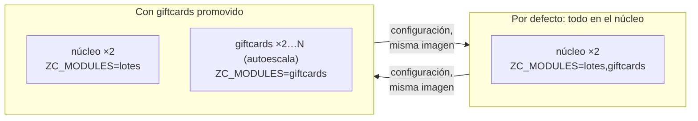
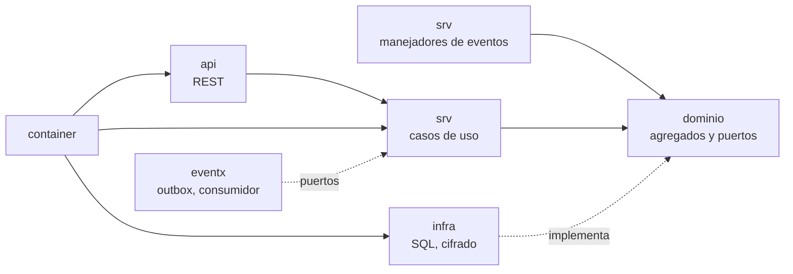

# Arquitectura

Este documento explica cómo se organiza la aplicación en módulos, cómo está construido cada
módulo, qué aporta la librería interna, cómo se corresponde con Manifesto y qué reglas hacen
correcta la saga de emisión.

## Una aplicación, varios módulos

Zonacards es **una aplicación** que se compila en **una imagen**. Dentro hay módulos, uno por
dominio (`lotes` y `giftcards`), y cada uno es dueño de sus reglas, de su esquema de base de
datos, de su API y de sus colas.

```
app/src/main/java/com/zonacards/
  app/          AppContainer: la lista de módulos y lo poco que comparten (reloj, códec de eventos)
  lotes/        un módulo: dominio + srv, infra, api, container, events
  giftcards/    otro módulo, con la misma forma
app/src/main/resources/
  application.properties
  db/lotes/  db/giftcards/        migraciones de cada módulo
```

La imagen **contiene** siempre todos los módulos. Un despliegue **atiende** solo los que lista
en `ZC_MODULES`:

| Despliegue | `ZC_MODULES` | Qué es |
|---|---|---|
| núcleo, por defecto | `lotes,giftcards` | Un servicio con toda la aplicación |
| núcleo, con `giftcards` promovido | `lotes` | El mismo servicio, sin ese módulo |
| servicio propio de `giftcards` | `giftcards` | La misma imagen, atendiendo un módulo y escalando por su cuenta |



Pasar de una forma a la otra no cambia código ni versión. Por qué es así, y lo que cuesta, está
en `docs/decisiones.md` (decisiones 1 a 4); el procedimiento, en `docs/operacion.md`.

### Qué significa atender, o no, un módulo

Lo decide `libs/server`, igual para cualquier módulo:

| | Módulo atendido | Módulo no atendido |
|---|---|---|
| Su grafo de objetos | Se construye **al arrancar**, tras comprobar que el despliegue trae sus topics, sus colas y sus llaves (`Preflight`). Si falta algo, la tarea no arranca | **No se construye**: el despliegue no necesita sus credenciales, sus colas ni sus llaves |
| Su API | Responde | `404` con el cuerpo de error estándar y el código `MODULE_NOT_SERVED` (`ModuleRoutingFilter`), sin instanciar nada |
| Sus consumidores y su *relay* | Corren | No arrancan |
| Su *datasource* | Activo, con el rol `<módulo>_app` | Inactivo: sin conexiones y sin comprobación de salud |
| *Liveness* | Sus bucles aparecen como `<módulo>/<bucle>`; si un módulo atendido no está corriendo, la tarea se declara no viva | No aparece |
| Métricas | Con la etiqueta `module` | No se publican |

- `ZC_MODULES` es **obligatoria** fuera de desarrollo y pruebas, y un nombre que la aplicación
  no contiene **impide arrancar**: una tarea sana que no atiende nada sería peor que una que
  falla (`ActiveModules`).
- La activación de cada *datasource* se deriva de `ZC_MODULES`
  (`ModulesConfigSourceFactory`): no hay una segunda bandera que mantener en sincronía.
- Al apagar, los módulos se detienen **a la vez y bajo un solo plazo**; uno tras otro
  necesitarían el doble del tiempo que el orquestador concede (`ModuleLifecycle`).
- `ZC_MODE=migrate` no arma ningún módulo: aplica las migraciones de todos, cada una con el rol
  dueño de su esquema, y termina.

### Qué separa a los módulos

Compartir proceso no relaja ninguna frontera:

| Frontera | Cómo se impone | Dónde se comprueba |
|---|---|---|
| Código | Ningún módulo importa a otro; la raíz solo conoce el contenedor de cada módulo; la librería interna no conoce ningún módulo | `ArchitectureTest` de cada módulo y `AppArchitectureTest` (ArchUnit) |
| Datos | Cada módulo se conecta con su propio rol, que solo ve su esquema: leer el del otro responde `42501` | `AppSagaIT.sharingAProcessDoesNotShareTheDatabase`; `make e2e aislamiento` |
| Transacciones | Una unidad de trabajo no puede abarcar dos módulos: el gestor de transacciones rechaza la segunda conexión | la misma prueba |
| Comunicación | Solo eventos por SNS → SQS, también dentro del mismo proceso | `AppSagaIT`: la saga completa en un proceso, por el emulador |

`AppArchitectureTest` comprueba además que todo módulo que existe en el código esté en la lista
del contenedor raíz: un paquete olvidado se compilaría en la imagen sin que nadie lo atendiera.

## El hexágono

Cada módulo contiene un dominio. Su código se organiza en seis paquetes con dependencias en
un solo sentido:

```
com.zonacards.<módulo>            agregados, objetos de valor, puertos, errores, requests
com.zonacards.<módulo>.events     eventos que publica; vista propia de los que consume
com.zonacards.<módulo>.srv        casos de uso y manejadores de eventos
com.zonacards.<módulo>.infra      adaptadores de salida (PostgreSQL, cifrado)
com.zonacards.<módulo>.api        adaptador de entrada (REST)
com.zonacards.<módulo>.container  composición: crea e interconecta todo lo anterior
```



| Regla | Por qué |
|---|---|
| El dominio y `srv` dependen solo del JDK y de la parte sin framework de la librería interna (`kernel`, `errx`, `logx`, `ptrx`, `asyncx`, puertos de `eventx`) | Las reglas del negocio se prueban sin levantar nada y sobreviven a un cambio de framework |
| `api` no conoce `infra` | La API habla con casos de uso, no con tablas |
| Solo `container` conoce todas las piezas | El cableado se lee en un archivo, no se deduce de anotaciones |
| Ningún módulo importa a otro | La única forma de llegar a otro módulo es un evento |
| No se usa `@Transactional`; la frontera es el puerto `UnitOfWork` | La transacción es explícita y visible en el caso de uso; JDBC fuera de ella falla en lugar de autoconfirmar |

Estas reglas las comprueba `HexagonRules.check("com.zonacards.<módulo>", <otros módulos>)`
(ArchUnit) en el `ArchitectureTest` de cada módulo, como lista de lo **permitido**: una
dependencia nueva que nadie previó falla el build. La propia regla tiene su prueba, con un
paquete correcto y otro que la viola (`libs/testkit/.../HexagonRulesTest`).

### Un caso de uso

Todos tienen la misma estructura, y el orden importa:

```java
// LoteService.anular, abreviado
public Lote anular(AuthContext auth, TenantId tenantId, LoteId id, String motivo) {
  Authz.require(auth, tenantId, LoteScopes.ANULAR);                 // 1. autorizar, antes de tocar nada
  // ... validar el motivo ...
  return uow.inTx(() -> {                                           // 2. una transacción
    Lote lote = repository.findForUpdate(tenantId, id)              // 3. cargar el agregado
        .orElseThrow(() -> LoteErrors.notFound(id));
    if (!lote.anular(reason, clock.instant())) {                    // 4. la regla vive en el agregado
      return lote;                                                  //    ya estaba anulado: nada que hacer
    }
    repository.update(lote);                                        // 5. persistir
    outbox.publish(LoteEvents.TOPIC, events.create(                 // 6. el evento, en la MISMA transacción
        LoteEvents.ANULADO, tenantId, id.value(), new LoteEvents.LoteAnulado(id.value(), reason)));
    return repository.get(tenantId, id);
  });
}
```

- `AuthContext` se pasa explícitamente: no hay contexto de seguridad ambiental en el dominio.
  La API lo construye desde el token; los manejadores de eventos, desde el `tenantid` del sobre.
- Las pruebas `*AuthzTest` construyen el servicio **sin repositorio** y con una unidad de trabajo
  que falla si se abre: cualquier caso de uso que haga algo antes de autorizar rompe la prueba.
- Los repositorios falsos de las pruebas unitarias están escritos a mano (sin *mocks*) y
  respetan aislamiento por tenant, unicidad y versiones, como el real.

### Composición explícita

`container/<Módulo>Container` es la única clase que conoce todas las piezas de su módulo. Su
constructor se lee de arriba abajo: comprobación de lo que trae el despliegue, adaptadores,
casos de uso, bucles de eventos. Todo se crea con `new`, con las dependencias en el
constructor; ni el dominio ni los servicios llevan anotaciones de CDI.

CDI solo entrega las piezas de la plataforma (el *datasource* del módulo, la unidad de trabajo,
los clientes de AWS) y crea el contenedor **la primera vez que el módulo hace falta**. El
contenedor raíz los recibe como `Instance<…>` precisamente por eso: en un despliegue que no
atiende el módulo, su contenedor nunca se crea.

```java
// com.zonacards.app.AppContainer: agregar un módulo es agregar una línea
return List.of(
    AppModule.of(LotesContainer.MODULE, LotesContainer.API, () -> lotes.get().eventx()),
    AppModule.of(GiftcardsContainer.MODULE, GiftcardsContainer.API, () -> giftcards.get().eventx()));
```

## La librería interna

| Módulo | Qué aporta | Depende de |
|---|---|---|
| `errx` | Errores tipados con código estable por dominio (`LOTE_NOT_FOUND`), tipo (validación, negocio, no encontrado, conflicto…) y su traducción a HTTP | JDK |
| `kernel` | Identificadores tipados (`LoteId`, `TenantId`…), UUID v7, `AuthContext`, `Actor`, *scopes* con comodines, `Authz`, `Validatable`, paginación, puerto `UnitOfWork` | `errx` |
| `logx` | Logs estructurados: `LOG.with("lote_id", id).info("…")` | JBoss Logging |
| `ptrx` | Utilidades mínimas para opcionales y valores por defecto | JDK |
| `asyncx` | `Backoff` con *jitter* y tope, `Retry`, `BoundedExecutor` (hilos virtuales con cupo), `ComputePool` (hilos de plataforma para trabajo de CPU) | JDK |
| `dbx` | Consultas JDBC con mapeadores, arreglos SQL, traducción de `SQLState`, `LocalUnitOfWork` | `kernel`, `errx` |
| `eventx` | Sobre CloudEvents, `Outbox`, `OutboxRelay`, `QueueConsumer`, `MessageDispatcher`, `Inbox`, registro de manejadores; adaptadores en memoria para pruebas | `kernel`, `asyncx`, Jackson |
| `eventx-postgres` | *Outbox* e *inbox* sobre PostgreSQL | `eventx`, `dbx` |
| `eventx-aws` | Publicación por SNS/SQS y recepción por SQS | `eventx`, AWS SDK v2 |
| `server` | Lo único que conoce Quarkus: qué módulos atiende el despliegue (`AppModule`, `ActiveModules`), su arranque con comprobación previa y su apagado, el `404` de un módulo no atendido, mapeo de errores a HTTP, `request_id`, `AuthContext` desde el JWT, `UnitOfWork` sobre JTA, *liveness* y métricas por módulo, trazas, punto de entrada con modo `migrate` | Quarkus |
| `testkit` | `HexagonRules`, fixtures de PostgreSQL y del emulador, tokens de prueba, contratos de eventos, espía de eventos | Testcontainers, ArchUnit |

## De Manifesto (Go) a Java

| Manifesto | Aquí | Nota |
|---|---|---|
| `pkg/kernel` | `libs/kernel` | Los tipos de identificador son `record`; `AuthContext` viaja como parámetro, igual que `context.Context` |
| `pkg/errx` | `libs/errx` | Un `ErrorRegistry` por dominio; los errores se comparan por código |
| `pkg/logx` | `libs/logx` | Campos estructurados sobre MDC; salida JSON |
| `pkg/ptrx` | `libs/ptrx` | Mínimo: en Java casi no hace falta |
| `pkg/asyncx` | `libs/asyncx` | Solo lo que se usa |
| `sqlx` | `libs/dbx` | SQL explícito, sin ORM |
| `pkg/config` | `@ConfigMapping` por módulo | Tipado y sobrescribible por variables de entorno |
| `cmd/server.go` y contenedores por módulo | `libs/server` + `com.zonacards.app.AppContainer` + `container/*Container` | Composición explícita; un módulo se arma solo donde se atiende |
| paquete raíz + `srv`, `infra`, `api`, `container` | igual | Fronteras verificadas con ArchUnit |
| Convenciones `Get` / `Find` / `List` | `get` (falla si no existe), `find` (opcional), `list` (paginado) | |
| `jobx` (cola sobre Redis) | no se porta | Lo reemplaza `eventx`, que sí es transaccional con la base |
| — | `libs/eventx*` | Lo nuevo: Manifesto no tiene eventos ni *outbox* |
| `iam`, `notifx`, `fsx`, `ai` | no se portan | La identidad la da Keycloak; el resto está fuera de alcance |

Se siguen las convenciones vigentes en la rama principal de Manifesto (contexto de
autorización explícito y autorización antes del repositorio).

## `eventx`: cómo viajan los eventos

**Sobre.** CloudEvents 1.0 en JSON, más tres extensiones: `tenantid`, `correlationid` y
`traceparent`. El `type` (`zonacards.<dominio>.<hecho>.v1`) viaja además como atributo del
mensaje, que es sobre lo que filtran las suscripciones de SNS.

**Publicación (outbox).** `outbox.publish(topic, evento)` inserta una fila en la tabla `outbox`
del esquema del módulo, en la transacción en curso. Cada tarea corre un *relay* por módulo que
atiende, y cada *relay*:

1. reclama un lote de filas pendientes con `FOR UPDATE SKIP LOCKED` y les pone un *lease*, en
   una transacción corta;
2. publica fuera de la transacción, en lotes de 10;
3. marca como publicadas solo las confirmadas; reprograma con espera creciente las que
   fallaron de forma transitoria y **aparta** (`parked_at`) las que el broker rechaza de forma
   permanente, para que no bloqueen al resto.

Varias tareas pueden correr el *relay* a la vez sin publicar dos veces la misma fila mientras
el *lease* esté vigente; si una tarea muere con filas reclamadas, otra las toma al vencer. Da
igual que esas tareas sean del mismo servicio o de dos: durante una promoción el núcleo y el
servicio propio corren el *relay* del mismo módulo sin coordinarse.

**Consumo.** Un hilo por cola hace *long polling*. Antes de pedir mensajes toma cupos de un
semáforo dimensionado contra el pool de conexiones, de modo que nunca tiene en memoria más
mensajes de los que puede procesar. Cada mensaje se procesa en un hilo virtual:

- manejador **transaccional**: *inbox* y efecto en la misma transacción; el mensaje se borra de
  la cola solo después de confirmar. Un duplicado encuentra su registro en el *inbox* y se descarta;
- manejador **autogestionado** (`onSelfManaged`): para trabajo largo. Hace su parte costosa
  fuera de la transacción y llama a `context.once(...)` para confirmar *inbox* y efecto juntos.

Mientras un mensaje se procesa, su *visibility timeout* se renueva. Si el manejador falla, el
mensaje vuelve a la cola con espera creciente y, tras `maxReceiveCount` intentos, pasa a la DLQ.

**Apagado.** Al recibir SIGTERM: se deja de pedir mensajes, lo recibido y no iniciado se
devuelve a la cola, se espera a lo que está en curso y al final se detiene el *relay*. Los
módulos de una tarea lo hacen en paralelo, bajo un mismo plazo.

**En el mismo proceso, igual.** Cuando `lotes` y `giftcards` comparten núcleo, un evento de uno
al otro sale por el *outbox*, va al topic, llega a la cola y se consume como si vinieran de
tareas distintas. No hay un atajo en memoria.

**Garantía.** Al menos una vez, sin orden. Es lo que dan SNS y SQS estándar, y es lo único que
el código asume.

## La saga de emisión

`lotes` es dueño del lote y de su estado; `giftcards` es dueño de las gift cards. Ninguno
espera al otro, y la saga es la misma compartan proceso o no: `AppSagaIT` la recorre con los dos
módulos en un proceso, y `make e2e` en las dos topologías.

1. `POST /lotes` guarda el lote en `SOLICITADO` y publica `lote-solicitado`.
2. `giftcards` crea un **plan** y encola un comando `generar-fragmento` por cada fragmento del
   lote. Publica `generacion-iniciada`.
3. Cualquier tarea que atienda `giftcards` toma un fragmento: genera códigos y hashes **fuera** de la
   transacción (es CPU pura, en un pool de hilos de plataforma) y luego, en una transacción,
   inserta las gift cards y publica `fragmento-generado`.
4. `lotes` registra cada fragmento; al completar el último pasa a `GENERADO` y publica
   `lote-generado`.

Lo que puede salir mal, y la regla que lo resuelve:

| Situación | Regla | Dónde se prueba |
|---|---|---|
| El mismo mensaje llega dos veces | *Inbox*: el segundo se descarta | `QueueConsumerTest`, `GeneracionSagaIT` |
| Llega otra vez mucho después, con el *inbox* ya purgado (un *redrive*) | Cada fragmento se **reclama** con un `UPDATE … WHERE estado = 'PENDIENTE'`; el plan se inserta con `ON CONFLICT DO NOTHING`. La idempotencia está en los datos, no solo en el *inbox* | `redeliveryLongAfterwardsWithThePurgedInboxChangesNothing` |
| Los fragmentos llegan desordenados y a varias tareas a la vez | Cada fragmento tiene su rango de secuencias; `lotes` lleva el progreso como un **conjunto** de fragmentos, no como un contador | `duplicatedUnorderedConcurrentDelivery…`, `LoteEventHandlersTest` (cientos de órdenes aleatorios) |
| Se anula el lote **mientras** se genera | Cada fragmento abre su transacción leyendo el plan con `FOR SHARE`; la anulación actualiza esa fila. O el fragmento confirma antes y la anulación lo ve y lo anula, o espera y encuentra el plan anulado. Nunca queda una gift card viva en un lote anulado | `anAnnulmentRacingWithTheGeneration…`; `make e2e anulacion` |
| La anulación llega **antes** que la solicitud | Deja una lápida (un plan `ANULADO` sin datos); la solicitud posterior la encuentra y no reparte trabajo | `anAnnulmentThatArrivesBeforeTheRequest…`; `make e2e anulacion` |
| Una tarea muere a mitad de un fragmento | Nada se confirmó: el mensaje reaparece al vencer su *visibility timeout* y otra tarea lo procesa | `aFailureBeforeTheCommit…`; `make e2e caida` |
| Dos códigos generados coinciden | Inserción con `ON CONFLICT (codigo_indice) DO NOTHING RETURNING`; los faltantes se regeneran en la misma transacción | `collidingCodesAreReplaced…` |
| No se puede completar un fragmento (fallo terminal) | Se publica `fragmento-fallido`, el plan queda `FALLIDO` y el lote pasa a `FALLIDO`; los demás fragmentos dejan de generarse | `whenNoUniqueCodeCanBeFound…` |
| Un manejador falla siempre por un defecto | Reintentos con espera creciente y, al agotarse, DLQ con alarma; tras corregir, *redrive* | `make e2e dlq` |
| Llega un evento sobre un lote en estado terminal | Se confirma y se registra en el log; no es un error | `LoteEventHandlersTest` |

Dos decisiones de diseño que conviene conocer:

- **El plan no se actualiza dentro de la transacción de un fragmento.** Hacerlo convertiría el
  bloqueo compartido en exclusivo y dos fragmentos concurrentes podrían bloquearse mutuamente.
  Saber cuándo terminó el lote es responsabilidad de `lotes`.
- **El trabajo de CPU no corre en hilos virtuales.** Un hash Argon2id ocupa un núcleo decenas de
  milisegundos; en una tarea de 1 vCPU dejaría sin tiempo al *polling* y a la renovación de
  visibilidad. Corre en `ComputePool`, con tantos hilos como núcleos.

## Datos

Una instancia PostgreSQL, un esquema por módulo, dos roles por módulo:

| Rol | Puede | Lo usa |
|---|---|---|
| `<módulo>_owner` | DDL sobre su esquema | solo la tarea de migración (Flyway) |
| `<módulo>_app` | `SELECT`, `INSERT`, `UPDATE`, `DELETE` sobre su esquema; con `CONNECTION LIMIT` | el *datasource* de ese módulo, en cualquier servicio que lo atienda |

Los crea `deploy/db/bootstrap-service.sql`, el mismo script en las pruebas, en docker compose y
en la tarea de *bootstrap* de AWS. `make e2e aislamiento` comprueba con los roles reales que un
módulo no puede leer el esquema del otro ni alterar el suyo.

Cada módulo tiene su *datasource* con nombre (`quarkus.datasource.lotes`,
`quarkus.datasource.giftcards`) y su propio *pool*. El límite de conexiones del rol se
dimensiona para el momento de más demanda: una promoción en curso, con el núcleo y el servicio
propio atendiendo el módulo a la vez (lo verifica Terraform).

La misma imagen corre en dos modos: `serve` (por defecto) y `ZC_MODE=migrate`, que aplica las
migraciones de todos los módulos, cada una con el rol dueño de ese módulo, y termina. El
pipeline la ejecuta como **una** tarea aparte antes de actualizar ningún servicio.

## Seguridad de los datos de la gift card

| Dato | Cómo se guarda | Para qué |
|---|---|---|
| Código (16 dígitos: país + 12 aleatorios + Luhn) | `codigo_cifrado`: AES-256-GCM con *nonce* aleatorio | Poder revelarlo en un proceso autorizado |
| | `codigo_indice`: HMAC-SHA256 con otra llave | Garantizar unicidad y buscar por código sin descifrar |
| | `codigo_mascara`: `604*********4321` | Mostrarlo en consultas |
| CVV (3 dígitos) | `cvv_hash`: Argon2id con sal por tarjeta | Verificarlo sin poder recuperarlo |

El código y el CVV en claro existen solo en la respuesta de la emisión unitaria. Las llaves son
secretos de 32 bytes que el módulo valida al arrancar, y que solo recibe un despliegue que lo
atiende. El puerto `CodigoProtector` permite
sustituir el adaptador local por uno sobre KMS sin tocar el dominio.

Dos límites conocidos: la emisión unitaria no es idempotente (un reintento emite otra tarjeta;
la creación de lotes sí lo es), y la rotación de llaves requiere un proceso de recifrado que
este ejemplo no incluye.
