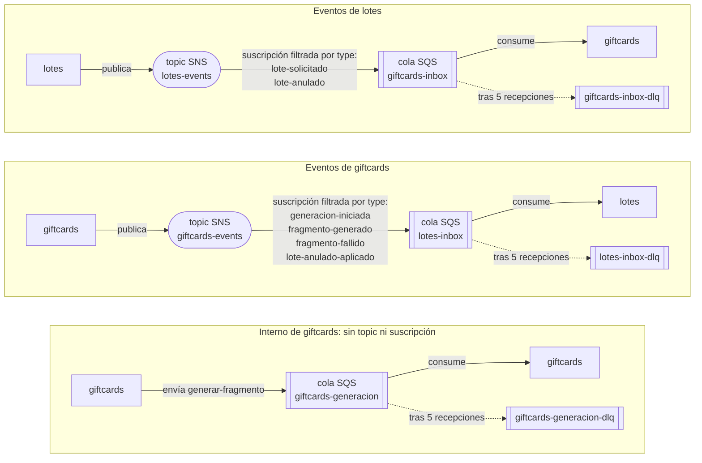

# Contrato de eventos de Zonacards

Los módulos `lotes` y `giftcards` no se llaman entre sí: se comunican solo por eventos. Cada
uno publica en su propio topic SNS y cada consumidor lee de su propia cola SQS. Este directorio
es el contrato de esos mensajes. No hay código compartido entre los dos módulos: el contrato es
el JSON que aquí se describe, y cada lado declara en su propio código la parte que usa.

Los dos módulos son partes de **una misma aplicación** y pueden correr en el mismo proceso (el
núcleo) o en servicios distintos (cuando uno se promueve). Para este contrato no hay diferencia:
un evento sale por el *outbox*, va al topic y llega a la cola **también cuando emisor y
receptor comparten proceso**. No existe un camino en memoria. Por eso un módulo puede pasar a
servicio propio, o volver, sin que cambie nada de lo que aquí se describe.

| Archivo | Contenido |
|---|---|
| [`asyncapi.yaml`](asyncapi.yaml) | Especificación AsyncAPI 3.0: canales, operaciones, sobre y esquema JSON de cada `data`. |
| [`ejemplos/<type>.json`](ejemplos/) | Un ejemplo por tipo de evento (11). Son normativos: las pruebas de productor y consumidor se ejecutan contra ellos. |
| `README.md` | Este documento. |

Contenido: [1. Sobre](#1-sobre) · [2. Nombres de tipo](#2-nombres-de-tipo) ·
[3. Catálogo](#3-catálogo-de-eventos) · [4. Comando interno](#4-comando-interno) ·
[5. Garantía de entrega](#5-garantía-de-entrega) · [6. Topología](#6-topología) ·
[7. Versionado](#7-versionado-y-evolución) · [8. Ejemplos como pruebas](#8-los-ejemplos-como-pruebas-de-contrato)

## 1. Sobre

Todo mensaje es un documento CloudEvents 1.0 en modo estructurado JSON: el cuerpo del mensaje es
un único objeto JSON con los atributos del sobre y, dentro de `data`, la carga. Lo arma
`EventFactory` y lo serializa `EventCodec` (`libs/eventx`).

```json
{
  "specversion": "1.0",
  "id": "019a9c2e-7b10-7c3a-9f41-0d6b2a5e1c77",
  "source": "/zonacards/lotes",
  "type": "zonacards.lotes.lote-solicitado.v1",
  "subject": "019a9c2e-6f04-7d21-8b5e-3c1a9e7f2b10",
  "time": "2026-11-18T15:04:05.123Z",
  "datacontenttype": "application/json",
  "tenantid": "pe",
  "correlationid": "6f1c2d0e-3b7a-4c55-9e0f-2a4b6c8d0e11",
  "traceparent": "00-4bf92f3577b34da6a3ce929d0e0e4736-00f067aa0ba902b7-01",
  "data": { "loteId": "019a9c2e-6f04-7d21-8b5e-3c1a9e7f2b10", "pais": "604", "moneda": "PEN", "monto": 50.00, "cantidad": 5000, "vigenciaHasta": "2027-12-31" }
}
```

| Atributo | Origen | Presencia | Formato | Contenido |
|---|---|---|---|---|
| `specversion` | CloudEvents | siempre | cadena | `"1.0"`. |
| `id` | CloudEvents | siempre | UUID versión 7 | Único por evento. Los consumidores deduplican por él: una reentrega trae el mismo `id`. Es también la clave de la fila en el outbox del productor. |
| `source` | CloudEvents | siempre | referencia URI | Módulo que produjo el evento: `/zonacards/lotes` o `/zonacards/giftcards`. |
| `type` | CloudEvents | siempre | cadena | `zonacards.<dominio>.<hecho>.v<mayor>` (sección 2). Determina el esquema de `data`. |
| `subject` | CloudEvents | siempre | UUID | Identificador del agregado del que habla el evento: el `loteId` o el `giftCardId`. |
| `time` | CloudEvents | siempre | instante ISO-8601 en UTC | Momento en que el productor creó el evento, dentro de la transacción de negocio. No es la hora de publicación ni la de entrega. |
| `datacontenttype` | CloudEvents | siempre | cadena | `"application/json"`. |
| `tenantid` | **extensión** | siempre | cadena | Tenant dueño del agregado (por ejemplo `pe`). En un evento nacido de una petición HTTP es el `tenant_id` del token de quien la hizo; en uno nacido de otro evento, el del evento consumido. El handler del consumidor solo puede tocar filas de ese tenant. |
| `correlationid` | **extensión** | siempre | cadena | Une todo lo causado por una misma petición. Se fija en los dos puntos de entrada de un módulo (una petición HTTP: la cabecera `X-Request-ID` si llega con forma válida, o un UUID nuevo; un mensaje consumido: el `correlationid` de ese mensaje) y se copia en cada evento producido mientras se atiende. Un mismo valor recorre así los dos dominios. |
| `traceparent` | **extensión** | opcional | `00-<trace-id>-<span-id>-<flags>` (W3C Trace Context) | Span del productor en el momento de escribir el evento en el outbox. El consumidor abre su span como hijo de este. Se omite cuando no hay un span válido. |
| `data` | CloudEvents | siempre | objeto JSON | Carga del evento. Su esquema pertenece al productor y se versiona con `type`. |

Los atributos de extensión son `tenantid`, `correlationid` y `traceparent`; el resto son
atributos de la especificación (`subject`, `time` y `datacontenttype` son opcionales en
CloudEvents, pero aquí el productor siempre los escribe). Los nombres van en minúsculas, como
exige CloudEvents.

Reglas de formato:

- **Ausente, no `null`.** Un atributo o campo sin valor se omite del JSON.
- **Importes.** `monto` es un número JSON escrito con exactamente dos decimales y sin notación
  exponencial: `50.00`, nunca `5E+1`, `50.0` ni `"50.00"`. Debe leerse como decimal exacto
  (`BigDecimal`), no como coma flotante binaria. JSON Schema no puede expresar la escala, así que
  el esquema solo dice `number`; la escala la comprueban las pruebas de `EventCodec` y de la API.
- **Fechas.** `time` es un instante ISO-8601 en UTC (`2026-11-18T15:04:05.123Z`). `vigenciaHasta`
  es una fecha ISO-8601 sin hora (`2027-12-31`).
- **Identificadores.** `id`, `subject`, `loteId` y `giftCardId` son UUID versión 7 en texto.
- **País y moneda.** `pais` es ISO 3166-1 numérico de tres dígitos (`604`); `moneda` es ISO 4217
  de tres letras mayúsculas (`PEN`).
- **Límites superiores.** Los máximos que el productor valida hoy en su API (`monto` hasta
  `9999999.99`, `cantidad` hasta 200000, `motivo` hasta 300 caracteres) figuran en las
  descripciones del esquema y no como restricciones: son validaciones de la API del productor,
  no algo que el consumidor compruebe.

**Atributos de mensaje.** Además del cuerpo, cada mensaje lleva dos atributos de mensaje de
SNS/SQS de tipo `String` (`AwsMessageSender`): `type` y `tenantid`, con el mismo valor que en el
sobre. `type` es el atributo sobre el que filtran las suscripciones; un mensaje publicado sin él
no pasa ningún filtro. Las suscripciones usan entrega sin envoltura (*raw message delivery*): el
cuerpo que llega a la cola es exactamente el JSON publicado, sin el envoltorio de SNS, y los
atributos de mensaje se conservan. El consumidor despacha por el `type` del cuerpo; el atributo
solo lo usa en métricas y logs.

**Qué exige el lector.** `EventCodec.decode` rechaza un cuerpo que no es JSON o al que le faltan
`id` o `type`, e ignora los atributos y campos que no conoce. Un handler necesita además `data`
con la forma de su propia vista del evento y, para encontrar el agregado, `tenantid`.

## 2. Nombres de tipo

```
zonacards.<dominio>.<hecho>.v<mayor>
```

- `<dominio>`: el dominio dueño del mensaje y único que lo produce (`lotes`, `giftcards`).
- `<hecho>`: lo ocurrido, en pasado y con guiones (`lote-solicitado`, `fragmento-generado`). Un
  comando interno usa el infinitivo (`generar-fragmento`).
- `v<mayor>`: versión mayor del esquema de `data`. Solo cambia con un cambio incompatible
  (sección 7). Hoy todos los tipos son `v1`.

El tipo completo es a la vez el valor del atributo `type` del sobre, el del atributo de mensaje
`type`, el valor que aparece en los filtros de suscripción y el nombre del archivo de ejemplo
(`ejemplos/<type>.json`).

## 3. Catálogo de eventos

Las constantes y los records de cada productor están en `LoteEvents`
(`app/.../lotes/events/`) y `GiftcardsEvents`
(`app/.../giftcards/events/`). La vista de cada consumidor está en el
paquete `events` del consumidor (`GiftcardsEvents` en lotes, `LotesEvents` en giftcards).

`lotes` publica en el topic `lotes-events` con `source` `/zonacards/lotes`; `giftcards` publica en
`giftcards-events` con `source` `/zonacards/giftcards`.

| `type` | Productor | Consumidores | Cuándo se emite | Campos de `data` |
|---|---|---|---|---|
| `zonacards.lotes.lote-solicitado.v1` | `lotes` | `giftcards` | `LoteService.crear`: al crear un lote por la API. Un `POST` reintentado con la misma `Idempotency-Key` no publica un segundo evento. | `loteId`, `pais`, `moneda`, `monto` (valor de cada gift card), `cantidad` (gift cards a generar), `vigenciaHasta` |
| `zonacards.lotes.lote-anulado.v1` | `lotes` | `giftcards` | `LoteService.anular`: la primera vez que se anula el lote, en cualquier estado (antes, durante o después de la generación). | `loteId`, `motivo` |
| `zonacards.lotes.lote-generado.v1` | `lotes` | ninguno hoy | `LoteEventHandlers.onFragmentoGenerado`: al registrar el último fragmento; el lote pasa a `GENERADO`. Una vez por lote. | `loteId`, `cantidad` (total de gift cards generadas) |
| `zonacards.lotes.lote-fallido.v1` | `lotes` | ninguno hoy | `LoteEventHandlers.onFragmentoFallido`: cuando un fragmento fallido lleva a `FALLIDO` un lote que no estaba en estado terminal. | `loteId`, `motivo` (`Fragmento <n>: <motivo del fragmento>`) |
| `zonacards.giftcards.generacion-iniciada.v1` | `giftcards` | `lotes` | `GeneracionHandlers.onLoteSolicitado`: al guardar el plan de generación del lote. No se emite si el lote ya tenía plan o ya estaba anulado. | `loteId`, `totalFragmentos` |
| `zonacards.giftcards.fragmento-generado.v1` | `giftcards` | `lotes` | `GeneracionHandlers.onGenerarFragmento`: al guardar las gift cards de un fragmento. Un evento por fragmento, no por gift card. | `loteId`, `fragmento` (desde 1), `totalFragmentos`, `cantidad` (gift cards del fragmento) |
| `zonacards.giftcards.fragmento-fallido.v1` | `giftcards` | `lotes` | `GeneracionHandlers.onGenerarFragmento`: fallo definitivo de un fragmento (reintentar no ayudaría). El plan queda `FALLIDO` y el resto de fragmentos se abandona. | `loteId`, `fragmento`, `motivo` |
| `zonacards.giftcards.lote-anulado-aplicado.v1` | `giftcards` | `lotes` | `GeneracionHandlers.onLoteAnulado`: al anular el plan y, en la misma transacción, las gift cards del lote que existían. | `loteId`, `giftcardsAnuladas` (0 si no se había generado nada) |
| `zonacards.giftcards.giftcard-emitida.v1` | `giftcards` | ninguno hoy | `GiftCardService.emitir`: emisión de una gift card individual por la API. Las generadas por lote no producen este evento. | `giftCardId`, `pais`, `moneda`, `monto`, `vigenciaHasta` (nunca el código ni el CVV) |
| `zonacards.giftcards.giftcard-activada.v1` | `giftcards` | ninguno hoy | `GiftCardService.activar`: la gift card pasa a `ACTIVA`. Activar una ya activa no publica nada. | `giftCardId` |
| `zonacards.giftcards.giftcard-anulada.v1` | `giftcards` | ninguno hoy | `GiftCardService.anular`: anulación individual por la API. La anulación en bloque por lote no produce este evento. | `giftCardId`, `motivo` |

`subject` es el `loteId` en los ocho primeros y el `giftCardId` en los tres últimos.

«Ninguno hoy» significa que el tipo no figura en el filtro de ninguna cola de la topología
(`infra/terraform/modules/messaging/topology/outputs.tf`): el evento se publica en el topic, pero
ninguna cola de este repositorio lo recibe.

Secuencias que forman estos eventos:

- Generación: `lote-solicitado` → `generacion-iniciada` → un `fragmento-generado` por fragmento
  (en cualquier orden) → `lote-generado`.
- Anulación: `lote-anulado` → `lote-anulado-aplicado`.
- Fallo: `fragmento-fallido` → `lote-fallido`.

## 4. Comando interno

`zonacards.giftcards.generar-fragmento.v1` no es un evento y **no forma parte del contrato
público**. Es una instrucción que `giftcards` se envía a sí mismo
(`GeneracionCommands.GenerarFragmento`).

| | |
|---|---|
| Quién lo envía | `giftcards`, en `GeneracionHandlers.onLoteSolicitado`: un comando por fragmento del lote, en la misma transacción que el plan y que `generacion-iniciada`. |
| Quién lo ejecuta | `giftcards`, en `GeneracionHandlers.onGenerarFragmento`. |
| Canal | Cola SQS `giftcards-generacion`, sin suscripción a ningún topic. El outbox lo envía directo a la cola (`Outbox.sendAll`), no a `giftcards-events`. |
| Sobre | El mismo que los eventos, con los mismos atributos de mensaje. `source` es `/zonacards/giftcards` y `subject` el `loteId`. |
| `data` | `loteId`, `fragmento`, `totalFragmentos`, `desdeSecuencia` (primera posición del fragmento dentro del lote), `cantidad`. El fragmento cubre las secuencias `desdeSecuencia` a `desdeSecuencia + cantidad - 1`. |

Por qué viaja por una cola y no por el topic público:

- **Un comando no es un hecho.** Un topic lleva hechos para quien quiera suscribirse; una cola
  lleva instrucciones que un dominio da a sus propios trabajadores y que nunca salen de él
  (`DestinationKind`). Publicarlo en el topic lo convertiría en contrato.
- **Puede cambiar con el código.** Al no ser público no está sujeto a las reglas de la sección 7
  ni tiene archivo en `ejemplos/`.
- **Es la unidad de trabajo y de escalado.** Un lote se divide en fragmentos de 1000 gift cards
  por defecto (`ZC_GIFTCARDS_FRAGMENT_SIZE`); un lote de 200000 son 200 comandos. Cualquier tarea
  que atienda el módulo puede tomar cualquier fragmento, y la profundidad de esta cola es la
  señal con la que escala su servicio cuando el módulo está promovido.
- **Es trabajo pesado.** Generar un fragmento es intensivo en CPU (un hash de CVV por gift card).
  La cola tiene por eso un tiempo de visibilidad de 300 s y una alarma de antigüedad de 1800 s,
  frente a los 60 s y 600 s de las colas de eventos, y su consumidor procesa 2 mensajes a la vez
  por tarea en lugar de 4.
- **Permisos.** En la aplicación, solo el módulo `giftcards` conoce esa cola. En AWS pueden
  enviar a ella y consumirla los servicios que pueden atender el módulo: el núcleo y, si
  existe, el servicio propio de `giftcards` (`infra/terraform/modules/platform/catalog.tf`).

En `asyncapi.yaml` aparece al final de cada sección, con la etiqueta `interno`.

## 5. Garantía de entrega

**Al menos una vez y sin orden** (*at-least-once, unordered*). Exactamente:

- **No se pierde ningún evento.** El evento se guarda en la tabla `outbox` en la misma
  transacción que el cambio de estado: o existen los dos o ninguno. Un bucle aparte
  (`OutboxRelay`) lo publica después y reintenta sin límite los fallos transitorios. Solo se
  aparta, para el operador, un mensaje que el broker rechaza por inválido.
- **Puede llegar repetido.** Si el relay cae entre publicar y marcar como publicado, vuelve a
  publicar al vencer su reserva. SQS reentrega un mensaje que no se confirmó a tiempo, cuyo
  handler falló o cuyo borrado falló tras confirmar la transacción.
- **No hay orden**, ni global ni por lote. Los topics y las colas son estándar, no FIFO; cada
  tarea que atiende un módulo ejecuta su relay; cada consumidor procesa varios mensajes a la vez;
  y un mensaje fallido se reentrega más tarde, cuando otros ya pasaron.

No se garantiza entrega exactamente una vez ni orden de llegada. Lo que sí se garantiza es el
efecto: cada consumidor está escrito para que el resultado sea el mismo con duplicados y en
cualquier orden.

### 5.1 Mecanismo común: inbox

Lo aplica `MessageDispatcher` (`libs/eventx`) antes de cada handler, en los dos módulos:

- Tabla `inbox` con clave `(consumer, message_id)`: el consumidor (`lotes` o `giftcards`) y el
  `id` del sobre. El registro se inserta con `ON CONFLICT DO NOTHING` **en la misma transacción**
  que los efectos del handler. Una segunda entrega encuentra el registro, no ejecuta el handler y
  se confirma. Si dos tareas reciben el mismo mensaje a la vez, la segunda espera a la primera
  transacción y luego ve el registro, o continúa si la primera se deshizo.
- El mensaje se borra de la cola solo después de confirmar la transacción.
- Los registros de la inbox se purgan a los 14 días. Por eso los handlers no dependen solo de
  ella: son idempotentes también sobre su propio estado (5.2 y 5.3).
- El tenant sale del sobre: un handler solo lee y modifica filas de ese `tenantid`. Un mensaje
  que nombra un lote o un plan de otro tenant no cambia nada y se confirma.
- Un tipo sin handler se confirma y se descarta. Los filtros deberían impedirlo; el consumidor lo
  tolera.

### 5.2 `lotes` (`LoteEventHandlers`)

Cada handler se ejecuta entero en una transacción junto con el registro de la inbox, y primero
bloquea la fila del lote (`SELECT ... FOR UPDATE`): dos eventos del mismo lote se aplican de uno
en uno. Si el lote no existe para el tenant del sobre, el evento se registra en el log y se
descarta.

| Evento | Con duplicados | Con desorden |
|---|---|---|
| `generacion-iniciada` | Solo actúa si el lote está en `SOLICITADO`; en cualquier otro estado no cambia nada. | Puede llegar después de los primeros fragmentos: para entonces el lote ya está en `EN_GENERACION` y el evento no tiene efecto. |
| `fragmento-generado` | El avance es un conjunto de números de fragmento, no un contador: la tabla `lote_fragmento` tiene clave `(lote_id, fragmento)` y la inserción usa `ON CONFLICT DO NOTHING`. Un fragmento cuenta una vez por muchas veces que llegue su evento, incluso con la inbox ya purgada. | No necesita `generacion-iniciada`: cada evento trae `totalFragmentos`. Los fragmentos se registran en el orden en que lleguen; el que completa el total pasa el lote a `GENERADO` y publica `lote-generado`, una sola vez. |
| `fragmento-fallido` | Solo actúa si el lote no está en estado terminal; la segunda entrega lo encuentra en `FALLIDO` y no publica otro `lote-fallido`. | Los fragmentos que lleguen después se ignoran (lote terminal). |
| `lote-anulado-aplicado` | Solo anota la confirmación la primera vez (`anulacionAplicadaEn` aún vacío). | Solo tiene efecto sobre un lote `ANULADO`. |

Un evento sobre un lote ya en estado terminal (`ANULADO`, `FALLIDO`, `GENERADO`) **se confirma y
se ignora; nunca se hace fallar**: fallar solo enviaría a la cola de mensajes muertos un mensaje
tardío inofensivo. Así, un lote anulado nunca se anuncia como generado aunque sigan llegando
fragmentos que estaban en curso.

### 5.3 `giftcards` (`GeneracionHandlers`)

| Mensaje | Con duplicados | Con desorden |
|---|---|---|
| `lote-solicitado` | El plan se inserta con `ON CONFLICT (lote_id) DO NOTHING`. Si ya existe, no se planifica nada: ni comandos ni `generacion-iniciada`. Plan, comandos y evento se confirman juntos. | Si `lote-anulado` llegó antes, encuentra el plan ya anulado (la lápida) y tampoco hace nada. |
| `lote-anulado` | Si el plan ya estaba anulado, no hace nada ni vuelve a publicar `lote-anulado-aplicado`. | Si la solicitud aún no llegó, crea el plan ya en `ANULADO` (lápida) y publica `lote-anulado-aplicado` con `giftcardsAnuladas` 0. Si hay fragmentos guardando gift cards, la anulación toma el bloqueo exclusivo del plan: espera a que terminen y, una vez confirmada, ningún fragmento puede guardar otra. Las gift cards existentes se anulan en esa misma transacción: nunca queda una gift card viva en un lote anulado. |
| `generar-fragmento` (interno) | El fragmento se marca con una actualización condicional (`... WHERE estado = 'PENDIENTE'`): otra entrega del mismo comando, simultánea o posterior, no actualiza nada y no guarda nada. Esto, y no la inbox, es lo que hace seguro reentregar un fragmento en cualquier momento. Además, `(lote_id, secuencia)` es única en `giftcard`. | Los fragmentos son independientes entre sí y los toma cualquier tarea. Antes de guardar se lee el plan con bloqueo compartido: si ya no está `EN_CURSO` (anulado o fallido), el fragmento no se guarda. |

`generar-fragmento` es el único handler que gestiona su propia transacción
(`HandlerRegistry.onSelfManaged`): la parte cara se ejecuta sin transacción ni conexión a la base
de datos, y el guardado, junto con el registro de la inbox, en una transacción corta. Si la tarea
muere antes de confirmar, no se guardó nada y el comando vuelve a la cola.

### 5.4 Fallos, reintentos y cola de mensajes muertos

- Un handler que lanza una excepción significa «reintentar más tarde»: el mensaje no se borra y
  se reentrega con una espera creciente (exponencial, de 2 s hasta 5 min, según el número de
  recepciones). Lo mismo le ocurre a un cuerpo que no se puede decodificar.
- Tras 5 recepciones sin confirmar, SQS mueve el mensaje a la cola `<cola>-dlq`, que lo retiene
  14 días; un mensaje en ella activa la alarma `<cola>-dlq-not-empty`.
- Un resultado de negocio que nunca va a funcionar **no** lanza excepción: se registra y se
  anuncia con su evento. Por eso existe `fragmento-fallido`, y por eso los eventos tardíos se
  confirman.
- Mientras un handler sigue en curso, el consumidor renueva el tiempo de visibilidad del mensaje
  para que no se entregue a otra tarea.

## 6. Topología

Se declara una sola vez, en `infra/terraform/modules/messaging/topology/outputs.tf`, y la crea
`infra/terraform/modules/messaging` tanto en AWS como en el emulador local.



Cada bloque es un camino independiente: quien publica o envía a la izquierda, quien consume a la
derecha. Los dos módulos aparecen en varios bloques porque cada uno publica en su topic y
consume de las colas que le pertenecen. El diagrama es el mismo con los dos módulos en el
núcleo o con `giftcards` en su propio servicio: lo que cambia es en qué tareas corre cada caja.

| Cola | Suscrita a | Filtro (atributo de mensaje `type`) | Visibilidad | Consumidor |
|---|---|---|---|---|
| `giftcards-inbox` | `lotes-events` | `zonacards.lotes.lote-solicitado.v1`, `zonacards.lotes.lote-anulado.v1` | 60 s | `giftcards` |
| `lotes-inbox` | `giftcards-events` | `zonacards.giftcards.generacion-iniciada.v1`, `zonacards.giftcards.fragmento-generado.v1`, `zonacards.giftcards.fragmento-fallido.v1`, `zonacards.giftcards.lote-anulado-aplicado.v1` | 60 s | `lotes` |
| `giftcards-generacion` (interna) | ninguno | no aplica | 300 s | `giftcards` |

Resto de la configuración (`infra/terraform/modules/messaging`):

- **Suscripción.** Protocolo `sqs`, entrega sin envoltura (`raw_message_delivery = true`) y
  filtro con alcance `MessageAttributes` sobre `type`. La lista de tipos de un filtro no puede
  estar vacía: una cola de entrada nunca recibe todo por accidente. La política de cada cola de
  entrada solo admite `sqs:SendMessage` de SNS con origen en su topic.
- **Cola de mensajes muertos.** Cada cola tiene la suya, `<cola>-dlq`. `maxReceiveCount` es 5 y
  la DLQ retiene 14 días. La redirección está en la cola SQS, no en la suscripción SNS.
- **Retención y lectura.** Las colas retienen 4 días; la espera de lectura (*long polling*) es de
  20 s.
- **Alarmas.** Dos por cola: la DLQ no está vacía, y el mensaje más antiguo lleva esperando más
  de 600 s (1800 s en `giftcards-generacion`).
- **Tipo.** Topics y colas estándar, no FIFO. Cifrado con una llave KMS propia en AWS.
- **Nombres.** El código y Terraform usan nombres lógicos (los de esta tabla). El nombre físico
  es `<prefijo>-<nombre lógico>`, con prefijo `zonacards-<entorno>` (`zonacards-dev-lotes-inbox`,
  `zonacards-local-lotes-inbox`). Cada despliegue recibe por configuración el ARN del topic y la
  URL de las colas de los módulos que puede atender (`ZC_TOPIC_*_ARN`, `ZC_QUEUE_*_URL`) y no
  puede alcanzar lo que no se le dio.
- **Permisos.** Se derivan del catálogo de módulos de Terraform: quien atiende un módulo
  publica en su topic y consume de sus colas. El servicio propio de un módulo promovido tiene
  **solo** los de ese módulo. El núcleo tiene los de todos, también los de un módulo que en ese
  momento no atiende, para que el módulo pueda volver con un cambio de configuración. Dentro
  del núcleo la separación entre módulos no la da IAM sino el código (ArchUnit) y la base de
  datos (un rol por módulo).

## 7. Versionado y evolución

Reglas, tal como las aplica el código (`EventCodec`, `LoteEvents`):

1. **Dentro de `v1` solo hay cambios aditivos.** Añadir un campo a `data` o un atributo al sobre
   es compatible.
2. **Los consumidores ignoran lo que no conocen.** El lector no falla ante atributos o campos
   desconocidos, y cada consumidor declara su propia vista del evento con solo los campos que
   usa. Los esquemas de `asyncapi.yaml` no cierran `additionalProperties` por la misma razón: un
   validador de este contrato tampoco debe rechazar campos nuevos.
3. **Un cambio incompatible es un tipo nuevo.** Quitar o renombrar un campo, o cambiar su tipo o
   su significado, exige un tipo con la siguiente versión mayor (`...v2`), que se publica **en
   paralelo** con el anterior hasta que los consumidores hayan migrado.
4. **La versión viaja en `type`**, y por tanto en el atributo de mensaje y en los filtros. Un
   tipo `.v2` solo llega a una cola cuando su filtro lo lista, y solo se procesa cuando el
   consumidor registra un handler para él. Cada consumidor migra a su ritmo.
5. **El comando interno queda fuera de estas reglas**: cambia con el código de `giftcards`.

Qué hay que tocar en cada caso:

| Cambio | Productor | Contrato | Consumidor |
|---|---|---|---|
| Campo nuevo en `v1` | Record en la clase de eventos del productor. | `ejemplos/<type>.json` y el esquema en `asyncapi.yaml`. Es obligatorio: la prueba del productor falla si lo emitido tiene un campo que el ejemplo no documenta. | Nada, salvo que quiera usarlo: entonces lo añade a su vista. |
| Tipo nuevo `.v2` | Constante y record nuevos; publica `v1` y `v2`. | Archivo `ejemplos/<type>.json` nuevo y mensaje nuevo en `asyncapi.yaml`. | Vista y handler nuevos, y el tipo en `event_types` de su cola (`topology/outputs.tf`). Cuando ningún consumidor usa `v1`, el productor deja de publicarlo. |

## 8. Los ejemplos como pruebas de contrato

Cada archivo de `ejemplos/` es a la vez documentación y dato de prueba. Los dos lados se prueban
contra el mismo archivo y no comparten código. La utilidad es `ContractExamples`
(`libs/testkit/src/main/java/com/zonacards/testkit/ContractExamples.java`):

| Método | Lado | Qué hace |
|---|---|---|
| `load(type)` | ambos | Lee `docs/eventos/ejemplos/<type>.json`. Falla si el `type` del archivo no coincide con su nombre. |
| `assertMatches(type, producido)` | productor | Compara lo que el módulo emite realmente con el ejemplo: los mismos atributos de sobre (solo puede faltar `traceparent`), cada uno de la misma clase JSON, y exactamente los mismos campos de `data`, de la misma clase, de forma recursiva. Falla tanto si falta un campo como si sobra uno sin documentar. |
| `instance(type, tenantId, valores)` | consumidor | Construye un evento nuevo a partir del ejemplo: `id` nuevo, el tenant indicado y los valores dados sustituyendo campos de `data` (sustituir un campo que el ejemplo no tiene falla); si se sustituye `loteId`, `subject` toma ese valor. Es lo que la prueba entrega al handler. |

Si un productor cambia un campo, fallan sus propias pruebas en `assertMatches`, antes de afectar
a ningún consumidor. Y el consumidor se prueba con la forma que el productor tiene comprobada, no
con una escrita a mano.

Usos en las pruebas de cada módulo:

- **`lotes` como productor** — `LoteApiIT.creatingALoteAnswersAtOnceAndPublishesItsEvent`: crea
  un lote por HTTP, lee el evento del emulador con `EventSpy` (una cola suscrita al topic sin
  filtro, que ve el mensaje como lo vería otro dominio) y aplica
  `assertMatches("zonacards.lotes.lote-solicitado.v1", ...)`. Comprueba además el atributo de
  mensaje `type`, el `correlationid` y que el cuerpo contiene `"monto":50.00`. Otras pruebas de
  la misma clase hacen lo mismo con `lote-generado`, `lote-anulado` y `lote-fallido`.
- **`lotes` como consumidor** —
  `LoteApiIT.eventsFromGiftcardsDriveTheLoteToGeneratedWhateverTheirOrder`: construye con
  `instance` un `generacion-iniciada` y cuatro `fragmento-generado`, entrega cada uno dos veces y
  en orden aleatorio en la cola `lotes-inbox`, y exige que el lote termine en `GENERADO` con un
  único `lote-generado`.
- **`giftcards` como consumidor** — `GeneracionSagaIT`: los eventos `lote-solicitado` y
  `lote-anulado` salen de `instance` y se entregan directamente al `MessageDispatcher`,
  duplicados, desordenados y desde varios hilos, contra un PostgreSQL real.
  `GiftCardApiIT.aRequestedLoteIsGeneratedThroughTheWorkQueueAndThenAnnulled` hace el recorrido
  completo por las colas, entregando `lote-solicitado` dos veces.
- **`giftcards` como productor** — `GiftCardApiIT` aplica `assertMatches` a `giftcard-emitida`,
  `giftcard-activada`, `giftcard-anulada`, `generacion-iniciada`, `fragmento-generado` y
  `lote-anulado-aplicado`; `GeneracionSagaIT`, a `fragmento-fallido` y `lote-anulado-aplicado`.

Cobertura: los 11 tipos tienen una comprobación de productor, y los 6 tipos que alguien consume
se entregan a su consumidor a partir del ejemplo.

Alcance: `assertMatches` compara nombres de campo y clase JSON (cadena, número, objeto), no
valores ni formatos. Los formatos (UUID, fecha, patrón de país y moneda) están en los esquemas de
`asyncapi.yaml`, que aceptan los 11 ejemplos. El comando interno no tiene archivo de ejemplo; el
que aparece en `asyncapi.yaml` es solo ilustrativo.
